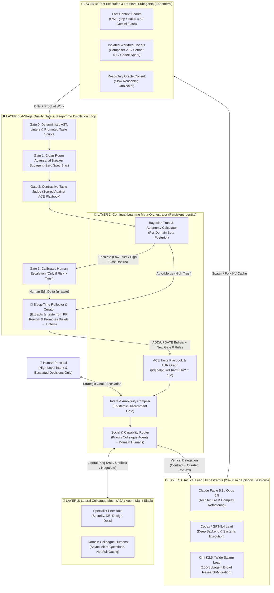

# Architectural Atlas of AI Agent Orchestrators & Blueprint for a Taste-Acquiring Meta-Orchestrator

> **Research Corpus Summary (October 2026)**
> This master document synthesizes source-code analysis across **58 cloned open-source repositories** (`repos/`) and **60+ commercial and open-source orchestrator systems**, broken down in full detail across five companion domain reports:
> - **[01 — Multi-Harness GUIs & Parallel Workspace Managers](file:///Users/jack/workspace/orchestrator-architecture/research/01-multi-harness-guis.md)** *(115 KB)*: Deep dive into **T3 Code Orchestrator V2**, Conductor, Vibe Kanban, Crystal, Nimbalyst, Claude Squad, Sculptor, Superset, Emdash, Agent Deck, Orchestrator.inc (`agent-orchestrator`), Omnara, Happy Coder, Terragon, CCManager, and Uzi.
> - **[02 — Harness-Internal Subagent & Multi-Agent Systems](file:///Users/jack/workspace/orchestrator-architecture/research/02-harness-subagents.md)** *(87 KB)*: Source-level breakdown of **OpenAI Codex CLI** (`multi_agent_v1` & `collaboration` V2), **OpenCode**, **Claude Code** (Subagents, Fork Subagents & Agent Teams), **Gemini CLI**, **Goose**, **Roo Code / Kilo Code / Cline**, **Amp**, **Factory Droids**, **Cursor**, **oh-my-opencode (OmO)**, **Crush**, and **Aider**.
> - **[03 — Persistent Multi-Agent Platforms & Cross-Agent Protocols](file:///Users/jack/workspace/orchestrator-architecture/research/03-persistent-agent-platforms.md)** *(110 KB)*: **xAI Grok Bot**, **OpenClaw**, **Nous Hermes Agent**, **Manus / OpenManus**, **Devin (Managed Devins & SWE-grep)**, **Cursor Cloud Agents**, **GitHub Copilot Agent HQ**, **Google Jules**, **Google Antigravity Agent Manager**, **OpenHands**, **Letta (MemFS & Sleep-Time Compute)**, **Kimi Agent Swarm (K2.5 PARL)**, **Moltbook**, and protocols (**Google A2A**, **MCP**, **Zed ACP**).
> - **[04 — Hierarchical Swarms & Multi-Agent Frameworks](file:///Users/jack/workspace/orchestrator-architecture/research/04-hierarchical-swarms-and-frameworks.md)** *(116 KB)*: **Gas Town / Gas City / Beads / Wasteland**, **MCP Agent Mail**, **Ruflo (`claude-flow`)**, **Anthropic Multi-Agent Research & 4 Generations of Long-Running Harnesses**, **Cursor Multi-Hundred-Agent Planner-Worker-Judge**, **OpenAI Symphony & Ralph Wiggum Loops**, **OpenAI Agents SDK**, **LangGraph**, **Microsoft AutoGen / Magentic-One**, **CrewAI**, **MetaGPT**, **ChatDev**, and **Google ADK**.
> - **[05 — Meta-Orchestrator Learning, Taste Acquisition & Human Know-How](file:///Users/jack/workspace/orchestrator-architecture/research/05-meta-orchestrator-learning.md)** *(57 KB)*: **Claude Fable 5 / 5.1 & Opus 5.5**, METR time-horizon scaling, **NVIDIA ToolOrchestra**, **Moonshot Kimi K2.5 PARL**, **Chroma Context Rot**, **ACE (Agentic Context Engineering)**, **Nous Hermes Background Review**, **Letta Sleep-Time Compute**, lateral colleague orchestration vs. vertical delegation, and a **5-Layer Continual-Learning Meta-Orchestrator Blueprint**.

---

## 1. The Evolutionary Arc of Orchestration (2024 $\rightarrow$ 2026)

Every AI orchestrator on the market today sits somewhere along a four-stage evolutionary curve:

```
Stage 1: Human-Driven Multi-Harness Multiplexing
  [Human] ──(switches/hands off context)──> [Claude Code] ⇄ [Codex] ⇄ [Gemini CLI]
  (Examples: T3 Code V1, Conductor, Claude Squad, Crystal, CCManager)

Stage 2: Harness-Internal Subagent Trees & Cross-Provider Delegation
  [Human] ──> [Primary Lead Agent (Claude/Fable/Codex)]
                    ├──(delegate_task / MCP)──> [Codex Worker Subagent]
                    ├──(Explore / Fast RL)────> [Haiku / SWE-grep / Flash]
                    └──(Oracle / Consult)─────> [Slow Reasoning Model]
  (Examples: T3 Code Orchestrator V2, Codex V2 Collaboration, Claude Code Subagents, Amp, OmO)

Stage 3: Persistent Peer Meshes & Hierarchical Factory Swarms
  [Human Overseer] ──> [Mayor / Sentinel / Planner]
                         ├──(Beads DAG / Task Board)──> [Ephemeral Polecats / Workers]
                         ├──(Peer Mail / A2A Ping)────> [Specialist Bots (Grok Bot, OpenClaw, Agent Mail)]
                         └──(Adversarial Gate)────────> [Refinery / Judge / Critic / Auditor]
  (Examples: xAI Grok Bot, OpenClaw, Gas Town + Beads, Cursor Planner-Worker-Judge, Antigravity Teamwork)

Stage 4: Continual-Learning Meta-Orchestrator (Replacing the Human Quality Gate)
  [Human Principal (Strategic Intent)]
         │
         ▼
  [Meta-Orchestrator (Long-Horizon Taste, Org Know-How, Lateral & Vertical Routing)]
         ├──Vertical Delegation──> [Fable 5 / Opus 5.5 / K2.5 Lead Orchestrators] ──> [Fast Workers]
         ├──Lateral Consultation─> [Colleague Agents & Domain Humans (Unblocking Context)]
         └──Sleep-Time Learning──> [Distills PR Rework Deltas & Failures into Playbooks/Linters/Weights]
```

---

## 2. Deep-Dive Answers to Your Core Architectural Questions

### 2.1 How Does Cross-Provider Context Handoff Work? (e.g., T3 Code Orchestrator V2: Codex $\leftrightarrow$ Claude)

When you do a session with one agent (say **Claude Code**) and switch mid-thread to another agent (say **OpenAI Codex**), and then switch back from Codex to Claude, **how does the second agent know what the first agent did without blowing up the context window or losing state?**

In **[T3 Code Orchestrator V2](file:///Users/jack/workspace/orchestrator-architecture/research/01-multi-harness-guis.md)** (`repos/t3code`), the architecture was completely rebuilt around an **event-sourced SQLite control plane** (`packages/orchestrator/src/Orchestrator.ts`, `EventStore.ts`, `ProjectionStore.ts`) that decouples three concepts:
1. **`AppThread`**: The user-facing conversation and shared timeline of `ThreadItem`s across all providers.
2. **`ProviderThread`**: A provider-specific conversation handle bound to `AppThread` + `provider` (`claudeCode` or `codex`).
3. **`ProviderSession`**: The live OS process / SDK connection (`ClaudeSdkRuntime` or `CodexAppServerRuntime`).

When you switch the active model selector on a thread from Claude to Codex (or back), T3 Code executes a **stateful delta handoff** (`Orchestrator.ts:prepareProviderThreadHandoff` and `packages/orchestrator/src/handoff/handoffBudget.ts`):

1. **Tracking `alreadyDeliveredItemIds` per Provider Thread**:
   The projection store tracks the exact set of `ThreadItem` IDs that each `ProviderThread` has already seen (`alreadyDeliveredItemIds`).
   - If you start in **Claude** (Turns 1–4), switch to **Codex** (Turns 5–7), and switch **back to Claude** on Turn 8, T3 Code does **not** re-send Turns 1–4 to Claude. It resumes Claude's existing `ProviderThread` (via the Claude SDK `resume` session ID) and computes only the **missing delta** (Turns 5–7 generated while Codex was driving).
2. **Deterministic Token-Budgeted Selection (`selectHistory`, 16,000-Token Cap)**:
   Rather than firing an expensive, lossy LLM summarization call during a provider switch, `handoffBudget.ts:selectHistory` runs a deterministic two-pass algorithm over the undelivered `ThreadItem`s within a **16,000-token budget** (`DEFAULT_HANDOFF_TOKEN_BUDGET = 16_000`):
   - **Pass 1 (User Prompt Spine)**: Walks newest-to-oldest and guarantees every **user message** is preserved so the incoming model never loses the human's evolving intent.
   - **Pass 2 (Assistant & Tool Summaries)**: Fills the remaining token budget with the most recent assistant responses and compact tool-call/diff summaries, dropping older verbose intermediate tool outputs first.
3. **Native vs. Inline Context Injection**:
   - **Into Codex**: Uses Codex App Server's native `thread/inject_items` RPC (`ProviderRuntime.ts`) to inject the structured handoff items directly into Codex's rollout before starting the turn.
   - **Into Claude Code**: Formats a structured `<context_handoff>` preamble block containing the selected delta items plus a pointer to any omitted items.
4. **Self-Service Pull for Omitted Context (`t3_thread_read`)**:
   If `selectHistory` had to drop older verbose tool outputs to stay under the 16k budget, the handoff block lists the omitted item ranges and tells the incoming agent it can call the MCP tool `t3_thread_read` on demand to pull full historical items if it actually needs them.
5. **Filesystem as the Ground Truth**:
   Because both providers run against the same isolated **Git worktree** (`GitWorktreeService`), the uncommitted file changes and git history *are* the ground truth of code state; the chat handoff only needs to convey **intent, decisions, and recent reasoning**.

Other products implement variations of this pattern:
- **Agent Deck** (`repos/agent-deck/internal/session/cross_harness_switch.go`): `CrossHarnessSwitchCoordinator` runs a two-phase verified handoff (`BuildClaudeToCodexHandoffPrompt`), extracting the last $N$ turns from Claude's JSONL transcript, injecting them into a newly spawned Codex session, and verifying the new harness responds before archiving the old pane.
- **Crystal** (`repos/crystal/main/src/services/contextCompactor.ts`): `ProgrammaticCompactor` builds a zero-LLM deterministic handoff bundle directly from SQLite tables (conversation prompts + git diff stats + active todo state) so any new CLI harness can pick up immediately.

---

### 2.2 How Can One Agent Spawn Subagents of *Another* Model/Provider? (e.g., Claude Spawning Codex Subagents)

Across the 58 repositories we inspected, there are **four concrete architectures** used today to let an agent of Model A (e.g., Claude Opus/Fable) spawn and orchestrate subagents of Model B (e.g., OpenAI Codex or Gemini):

| Architecture | How It Works | Real Products & Code Pointers |
|---|---|---|
| **1. Control-Plane Delegation Tool (`delegate_task`)** | The parent agent is given a built-in/MCP tool by the outer orchestrator. When Claude calls `delegate_task(provider: "codex", model: "gpt-5.4-codex", prompt: "...")`, the **outer control plane** spawns a child `ExecutionNode` on the Codex adapter, runs it to completion (or asynchronously), and injects the child's final output into the parent's `NotificationMailbox`. | **T3 Code V2** (`repos/t3code/packages/orchestrator/src/Orchestrator.ts` — `delegate_task`, `NotificationMailbox`, `ExecutionNode` with `countsForRun: false` so parent turn can yield and wake up when the Codex child finishes); **Omnara** (`repos/omnara` — `RuntimeContract` compiles multi-provider `spawn_agent` across `Depth 0..8`); **Vibe Kanban** (`orchestrator_mode_router` MCP `create_session` + `run_session_prompt`). |
| **2. Agent-as-MCP-Server (`codex mcp-server`)** | Any coding harness can expose itself as an MCP server over stdio/SSE. Claude Code mounts `codex mcp-server` (or Hermes `mcp_serve.py`) in its `.mcp.json`. To Claude, Codex appears as two MCP tools: `codex(prompt, sandbox, cwd)` and `codex-reply(conversationId, prompt)` for multi-turn follow-ups! | **OpenAI Codex CLI** (`repos/codex/codex-rs/mcp-server` — exposes `codex` and `codex-reply` MCP tools); **Hermes Agent** (`repos/hermes-agent/mcp_serve.py`); **OpenManus** (`repos/OpenManus/run_mcp.py`). |
| **3. Multi-Provider Harness-Internal Task Router** | A single harness natively speaks to Anthropic, OpenAI, and Google APIs (or ACP sub-processes) and assigns different models to named subagent roles in config. When the lead agent calls `task(subagent_type="oracle" \| "hephaestus" \| "explore")`, the harness dispatches that child session to a completely different provider. | **oh-my-opencode / OmO** (`repos/oh-my-opencode` — Claude `Sisyphus` orchestrator spawns GPT/Codex `Hephaestus` deep workers, `Oracle` slow reasoner, and Gemini/Haiku `Explore` scouts); **OpenCode** (`repos/opencode/packages/core/src/tool/plugin/subagent.ts`); **Goose** (`repos/goose` `summon` tool); **OpenClaw** (`sessions_spawn(runtime: "acp", agentId: "codex")`). |
| **4. Cross-Harness Peer Bridge (`send_agent_message`)** | Instead of parent-child spawning, long-lived sessions in different harnesses are bridged by a local router that injects messages into the target harness's native session store or stdin. | **Letta Code** (`repos/letta-code` — `send_agent_message` natively bridges Letta, `claude-code`, `codex`, and `opencode` sessions on the same machine, injecting `<system-reminder>` blocks); **MCP Agent Mail** (`repos/mcp_agent_mail` — shared FastMCP inbox across Claude, Codex, and Gemini agents). |

> [!IMPORTANT]
> **Privilege Monotonicity Guardrail in T3 Code V2**: When an agent spawns a subagent of another provider via `delegate_task`, T3 Code enforces a monotonic privilege ceiling (`runtimeMode` in `Orchestrator.ts`): a parent running in `approval-required` or `read-only` mode **cannot** spawn a child subagent in `full-access` (yolo) mode, preventing privilege escalation across model boundaries.

---

### 2.3 How Does Cross-Agent Messaging ("Pinging Another Agent") Work?

You mentioned **Grok Bot** supporting cross-agent messaging where one agent can ping another agent, raise a question, and get a response. Our research uncovered **five distinct cross-agent messaging paradigms** in production today:

1. **Account-Scoped Persistent Bot Mesh + Shared VM (**[**xAI Grok Bot**](file:///Users/jack/workspace/orchestrator-architecture/research/03-persistent-agent-platforms.md)**)**:
   - Under a single xAI account, users can run up to **50 persistent Bots**, each with its own role, instructions, memory, and up to 50 scheduled/event-triggered **Routines**.
   - **Messaging Between Bots** is enabled by default in the Grok Bot dashboard. Any bot can `@mention` / ping another bot by name or role, either in a direct 1-to-1 bot handoff or inside a **2-to-6 Bot Group Chat**.
   - **Zero-Copy Artifact Passing**: Every bot under the account shares the **same persistent cloud Linux computer (`/workspace`)** (while Team Bots get context-scoped VMs). Instead of serializing huge codebases or CSVs into chat messages, Bot A writes `/workspace/analysis/schema.sql` and pings Bot B with the file path.
   - **External Pinging via Google A2A**: To ping an agent *outside* xAI (e.g., a local Mastra or LangGraph agent), Grok Bot speaks the **Agent-to-Agent (A2A) protocol** (`/.well-known/agent-card.json`, `SendMessage` / `SendStreamingMessage`).
2. **Bounded Ping-Pong Session Messaging (**[**OpenClaw**](file:///Users/jack/workspace/orchestrator-architecture/research/03-persistent-agent-platforms.md) — `repos/openclaw`)**:
   - OpenClaw provides two distinct tools: `sessions_spawn` (hierarchical parent-child) and **`sessions_send`** (`src/agents/tools/sessions-send-tool.ts` & `sessions-send-tool.a2a.ts`).
   - With `sessions_send`, Agent A can ping Agent B synchronously (`timeoutSeconds > 0`, waiting for B's reply) or fire-and-forget (`timeoutSeconds = 0`).
   - To prevent two bots from getting stuck in an infinite "thank you / you're welcome" loop, `sessions-send-tool.a2a.ts` implements a **bounded ping-pong loop** (`maxPingPongTurns`, default 5) and instructs both agents to emit the sentinel token **`REPLY_SKIP`** the moment no further back-and-forth is needed.
3. **Hierarchical Path Addressing & Actor Mailboxes (**[**OpenAI Codex CLI V2**](file:///Users/jack/workspace/orchestrator-architecture/research/02-harness-subagents.md) — `repos/codex/codex-rs`)**:
   - In Codex's `collaboration` V2 architecture (`codex-rs/core/src/agent/`), every agent in the tree has a filesystem-like **`AgentPath`** (`/root`, `/root/planner`, `/root/planner/worker_1`).
   - Agents use two distinct tools:
     - `send_message`: Queues an asynchronous `InterAgentCommunication` envelope into the target agent's `Mailbox` without waking it.
     - `followup_task`: Queues the message **and** schedules an active turn on the target agent.
   - Crucially, `residency.rs` decouples **`Mailboxes`** (persistent in memory for the session lifetime) from **`ResidencySlot`s** (the live runtime process, which can be evicted when idle and transparently re-hydrated from its rollout log when a new `followup_task` arrives!).
4. **Shared Inbox/Outbox + Advisory File Reservations (**[**MCP Agent Mail**](file:///Users/jack/workspace/orchestrator-architecture/research/04-hierarchical-swarms-and-frameworks.md) & [**Claude Code Agent Teams**](file:///Users/jack/workspace/orchestrator-architecture/research/02-harness-subagents.md))**:
   - **MCP Agent Mail** (`repos/mcp_agent_mail` & `repos/mcp_agent_mail_rust`): Gives every coding agent (Claude, Codex, Gemini) a persistent identity (`adjective+noun` like `GreenCastle`), a SQLite+Git-backed inbox (`send_message`, `reply_message`, `fetch_inbox`, ` summarize_thread`), and **advisory file glob locks** (`file_reservation_paths`) enforced by a `pre-commit` git hook (`mcp-agent-mail-guard`). It intentionally **forbids broadcast-to-all** to prevent $O(N^2)$ token storms.
   - **Claude Code Agent Teams**: Teammates coordinate through `~/.claude/tasks/{team-name}/` (file-locked task JSONs with dependencies) and per-agent JSON mailboxes in `~/.claude/teams/{team-name}/inboxes/{agent-name}.json`.
5. **Sync, Async & Tag-Routed Messaging (**[**Letta**](file:///Users/jack/workspace/orchestrator-architecture/research/03-persistent-agent-platforms.md) — `repos/letta`)**:
   - Provides three explicit primitives in `letta/Create/functions/function_sets/multi_agent.py`:
     1. `send_message_to_agent_and_wait_for_reply` (synchronous RPC — caller blocks and gets reply in tool return).
     2. `send_message_to_agent_async` (asynchronous actor send — appends to target's inbox and returns immediately).
     3. `send_message_to_agents_matching_tags` (pub/sub broadcast/scatter-gather to all agents matching e.g. `["security-reviewer", "rust"]`).

---

### 2.4 Topologies, Depth Limits, and Why Flat Peer Swarms Fail at Scale

How deep are agent hierarchies in practice, and what topology works best?

| System | Max Hierarchy Depth | Max Concurrency | Topology Pattern |
|---|---|---|---|
| **Gemini CLI** / **Goose** / **Crush** | `1` (hard-enforced: subagent tool stripped from child) | 1–5 | Strict 1-level Hub-and-Spoke |
| **OpenCode** / **Codex V1** / **Cursor Subagents** | `1` default (configurable in OpenCode) | 6 (`DEFAULT_AGENT_MAX_THREADS` in Codex) | 1-level Hub-and-Spoke |
| **Hermes Agent** / **OpenClaw** | `2` (`MAX_DEPTH = 2` in Hermes; `maxSpawnDepth` in OpenClaw) | 5 children/agent (`maxConcurrent = 32` in Swarm) | 3-Tier Orchestrator $\rightarrow$ Sub-Orchestrator $\rightarrow$ Leaf Worker |
| **Claude Code Subagents** | `3` (`CLAUDE_CODE_MAX_SUBAGENT_SPAWN_DEPTH`) | `20` concurrent | Multi-tier tree + optional flat **Agent Teams** |
| **Gas Town / Gas City** | `3` (Overseer $\rightarrow$ Mayor/Deacon $\rightarrow$ Witness/Refinery/Polecats) | 20–30+ rigs/polecats | Industrial Factory Hierarchy + Dolt DAG (`Beads`) |
| **Omnara** | `8` (`MAX_SUBAGENT_DEPTH = 8`) | Unbounded | Compiled declarative `RuntimeContract` tree |
| **Google Antigravity** | `10` (hard nesting limit) | Multi-team | Sentinel $\rightarrow$ Project Orchestrator $\rightarrow$ Explorers/Workers $\rightarrow$ 4 Critics |
| **Kimi K2.5 Agent Swarm** | `1` (Orchestrator $\rightarrow$ up to 100 frozen subagents) | **100** subagents / 1,500 tool calls | Wide RL-trained dynamic fan-out |
| **Cursor Long-Running Harness** | Recursive **Planners** $\rightarrow$ **Workers** $\rightarrow$ **Judge** | **Hundreds** of workers | Recursive Planner-Worker-Judge (no Integrator) |

**Crucial Empirical Lesson from Cursor & Cognition**:
- When Cursor tried a **flat peer hierarchy** where 20 equal agents coordinated via file locks on a shared repo, effective throughput collapsed to **2–3 agents** due to lock contention. When they switched to optimistic concurrency without hierarchy, agents became risk-averse and cherry-picked trivial tasks.
- When Cursor introduced **Planners $\rightarrow$ Workers $\rightarrow$ Integrator**, the single Integrator became the bottleneck across ratusan workers. **Deleting the Integrator**—forcing Workers to handle their own localized merges while **Planners** recursively decompose tasks and a cycle-end **Judge** decides whether to continue—allowed them to scale to **hundreds of concurrent agents writing >1M lines of code** (building a web browser from scratch over weeks).
- Similarly, Cognition's 2025–2026 architecture evolved into **"distribute intelligence in parallel, keep writes single-threaded"**: one primary writer agent supported by parallel read-only subagents (`SWE-grep`, `Smart Friend`, `Devin Review`).

---

### 2.5 Fast Agents vs. Slow Agents: How They Cooperate

Every mature 2026 system rejects homogeneous model assignment in favor of a **3-tier cognitive hierarchy** (often combined with **RL-trained routing**):

1. **Tier 0 — Ultra-Fast Retrieval & Context Compression Subagents (~10–30$\times$ faster, Read-Only)**:
   - **Role**: Absorb noisy intermediate tool calls (grepping 50 files, reading docs, running bash probes) so the slow orchestrator's context window stays clean.
   - **Examples**:
     - **Cognition `SWE-grep` / Fast Context**: Custom RL-trained small model running at **>2,800 tokens/sec**, trained to fire **8 parallel read/grep calls per turn across at most 4 turns**, returning only the exact file spans to Devin's main planner.
     - **Claude Code `Explore` (`Haiku 4.5`)**: Read-only scout with `omitClaudeMd: true` (strips heavy project instructions to save input tokens) that searches the repo and returns a compact summary.
     - **Gemini CLI `CodebaseInvestigatorAgent` (`gemini-3-flash-preview`)** and **Crush `agentic_fetch`** (runs a small model inside a `/tmp/crush-fetch-*` sandbox to read web pages and return a summary).
2. **Tier 1 — High-Throughput Implementation & Execution Workers (Mid-Latency, Code-Specialized)**:
   - **Role**: Write code, run tests, and iterate on compiler/linter errors inside an isolated worktree or sandbox.
   - **Examples**: **GPT-5.4-Codex / Codex-Spark**, **Claude Sonnet 4.6**, **Cursor Composer 2 / 2.5**, **Kimi K2.5 Frozen Subagents**.
   - **Prefix-Sharing Optimization (`Fork Subagents`)**: Both **Claude Code** (`CLAUDE_CODE_FORK_SUBAGENT`) and **OpenAI Codex V2** (`fork_turns: "all"` in `codex-rs/core/src/agent/control/spawn.rs`) allow spawning a worker with a **byte-identical prefix** of the parent's conversation so the child hits **100% of the parent's prompt KV-cache** (paying $0.20/M instead of $2.00/M+ on input tokens!).
3. **Tier 2 — Slow Deep-Reasoning Orchestrators, Oracles & Judges (High-Compute, Long-Horizon)**:
   - **Role**: Decompose ambiguous goals, resolve architectural deadlocks, and act as skeptical quality gates.
   - **Examples**:
     - **Vertical Lead Orchestrator**: **Claude Fable 5 / 5.1**, **Claude Opus 5.5**, **GPT-5.4 Pro / GPT-6 Astra**.
     - **Lateral "On-Call Senior Architect" Subagent**: **Amp's `Oracle`**, **oh-my-opencode's `Oracle`**, and **Devin's `Smart Friend`**—invoked as a read-only consultation tool *only* when the worker hits a hard bug or design tradeoff.
     - **RL-Trained Cost-Aware Router**: **NVIDIA's `Nemotron-Orchestrator-8B`** (`repos/ToolOrchestra`) proves that a small **8B orchestrator model** trained with GRPO on outcome + cost + latency penalties (`training/lead_agent/llm_agent/generation_quick3.py`) can orchestrate frontier models (`GPT-5`, `Claude`, specialized tools) to **beat monolithic GPT-5 on Humanity's Last Exam (37.1% vs 35.1%) at 2.5$\times$ lower latency and 30% of the cost**.

---

### 2.6 Agent Lifespan, Context Rot, and How Long-Running Orchestrators Survive

How long can an agent live before its quality degrades, and how do systems keep an orchestrator alive for days or weeks?

1. **The Empirical Reality of Context Rot (Chroma Research & METR)**:
   - Even with 1M-token context windows, model reliability degrades sharply as context fills—a phenomenon Chroma's 18-model study termed **Context Rot**, driven by:
     1. *Attention dilution* across thousands of intermediate tool outputs.
     2. *Semantic distractors*—failed debugging hypotheses and abandoned stack traces in the transcript actively mislead later turns.
     3. *Instruction decay*—around **35+ minutes of continuous autonomous work**, adherence to negative constraints ("do not mock the database", "keep writes single-threaded") drops noticeably.
   - On **METR's Time-Horizon benchmarks (`TH1.1`, 2026)**, while **Claude Fable 5 / Mythos** reaches a **50% success horizon ($p_{50}$) of ~17.4 hours**, its **80% reliable horizon ($p_{80}$) is $4\text{–}6\times$ shorter (~2.5–3.5 hours)**. Production systems therefore **never** let a single context window run unchecked for 17 hours; they decompose work into **20-to-60-minute episodic worker lifespans**.
2. **Five Mechanisms Used to decouple "Agent Identity Lifespan" from "Context Window Lifespan"**:
   - **Pattern A — Subagents as Context Garbage Collectors**: Every subagent call is a context firewall. The child burns 80,000 tokens of file reads and test retries in its ephemeral context window and returns a **500-token structured summary** (`complete_task` in Gemini CLI; `TaskResult` in Claude Code) to the parent orchestrator.
   - **Pattern B — View-Layer / Hybrid Compaction**:
     - **OpenHands** (`repos/OpenHands`) keeps an immutable append-only `EventStore` on disk and applies an `LLMSummarizingCondenser` only as a *view projection* when constructing the next LLM prompt.
     - **OpenCode** (`repos/opencode`) keeps the most recent **15,000 tokens verbatim** while replacing older turns with a structured `<conversation-checkpoint>` summary.
     - **Manus** uses **Restorable Filesystem Compression**: stripping large tool outputs from the context window while keeping the file path/URL so the agent can re-read the exact bytes if needed, and reciting `todo.md` at the *end* of the context to combat lost-in-the-middle attention decay.
   - **Pattern C — Intentional Context Rotation (`gt handoff --cycle` & Milestone Succession)**:
     - In **Gas Town** (`repos/gastown`), persistent roles (**Mayor**, **Witness**, **Polecats**) do *not* rely on infinite context windows. When a session approaches ~70% context capacity, a `PreCompact` hook triggers `gt handoff --cycle`: the agent writes its current state to its pinned **Bead** (in the Dolt SQL database) and sends itself a handoff mail, then the `tmux` pane respawns a **brand-new Claude process** that runs `gt prime` + `gt mail check --inject` to resume with a fresh, un-rotted context window! If the new incarnation needs something the old one forgot to write down, it runs **`gt seance`**—which forks and resumes the predecessor's dead session (`claude --fork-session --resume <id>`) to interview its own past self!
     - In **Google Antigravity `/teamwork-preview`**, the **Project Orchestrator** practices **Milestone Succession**: at the end of each major milestone, the orchestrator writes a succession brief and retires, handing the baton to a fresh Project Orchestrator instance.
   - **Pattern D — Outer Ledger vs. Inner Ledger (**[**Magentic-One**](file:///Users/jack/workspace/orchestrator-architecture/research/04-hierarchical-swarms-and-frameworks.md) & [**Anthropic Two-Phase Harness**](file:///Users/jack/workspace/orchestrator-architecture/research/04-hierarchical-swarms-and-frameworks.md)**)**:
     - Maintain a persistent **Task Ledger** (`feature_list.json` with >200 pass/fail items, `boulder.json` in OmO, or Beads DAG) *outside* the LLM context, and an inner per-step **Progress Ledger** that detects stalls/loops and resets worker sessions when `stall_count > threshold`.
   - **Pattern E — Background Sleep-Time Memory Consolidation**:
     - **OpenClaw Dreaming** (Light $\rightarrow$ REM $\rightarrow$ Deep phases), **Letta Sleep-Time Agents** (`MemFS` Git-backed memory worktrees), and **Nous Hermes Background Review** (`repos/hermes-agent/agent/background_review.py`) continuously distill raw session transcripts into compact, durable `MEMORY.md`, `USER.md`, and `SKILL.md` files during idle periods.

---

## 3. Replacing the Human Meta-Orchestrator: Taste, Lateral Colleague Orchestration & Long-Horizon Know-How

Your central observation goes to the heart of where agentic AI is headed next:

> *"Suppose Fable 5 has really great orchestrating capabilities—even then, a human software engineer is still orchestrating Fable to orchestrate subagents. Right now the human is the quality gate because they have taste and years of experience from doing the work AND from orchestrating colleagues (not just as a team lead delegating down, but as a team member orchestrating peers to get the context/inputs needed to do the job). For a higher-level Meta-Orchestrator to replace that human, it has to acquire that know-how and taste over very long-horizon orchestration."*

Our research in **[05 — Meta-Orchestrator Learning & Taste Acquisition](file:///Users/jack/workspace/orchestrator-architecture/research/05-meta-orchestrator-learning.md)** confirms both why current orchestrators fail to replace the human principal and how the building blocks to solve this are emerging right now.

### 3.1 What "Fable 5" Actually Is — and Why Model Capability Alone Doesn't Give Taste
- **What Fable 5 Is**: **Claude Fable 5** (released June 9, 2026) and **Claude Fable 5.1** (Sept 1, 2026) are Anthropic's flagship "Mythos-class" general-availability models (1M context window, `$10`/`$50` per M tokens), with **Claude Opus 5.5** (Sept 22, 2026) bringing Fable 5.1-level coding and orchestration to `$3`/`$15` per M tokens (`$0.20`/M cached input).
- **Why Even Fable 5.1 / Opus 5.5 Still Needs a Human Meta-Orchestrator Today**:
  1. **Stateless Epistemic Priors**: Frontier models have immense *general* priors, but zero knowledge of your organization's unwritten architectural invariants, historical scars ("why we never use optimistic locking on the billing table"), customer risk tolerance, or who owns which service.
  2. **The "Gold-Like" Surface Bias of AI Judges**: Academic studies on LLM code review judges show that vanilla frontier models systematically prefer code that *looks* clean, verbose, and well-commented ("Gold-Like" bias) even when it introduces subtle architectural coupling, unnecessary abstractions, or over-engineering. Human senior engineers reject this immediately—that rejection *is* **taste**.
  3. **Blindness to Lateral Orchestration**: Every current multi-agent harness (`delegate_task`, `spawn_agent`, `Task`) models orchestration strictly as **vertical top-down task delegation** (Manager $\rightarrow$ Subordinate). In real human organizations, **at least half of orchestration is lateral**: a mid-level engineer doesn't "command" the payments team or the product designer; they *ping* a colleague ("Hey, does `InvoiceService` assume idempotency keys are UUIDv7?"), negotiate an API contract, ask for a sanity check, or unblock a dependency so they can do their own work better.

### 3.2 How Current Systems Capture Experience & Evolve Taste Without Forgetting

Three breakthroughs in our cloned repositories show how an agent can turn long-horizon experience into durable know-how without suffering context collapse:

1. **ACE — Agentic Context Engineering (`repos/ace`)**:
   - Instead of summarizing experience into a monolithic prompt (which suffers **Context Collapse**, shrinking 18,000 tokens of hard-won lessons into 120 generic words), ACE represents know-how as a living **itemized Playbook of atomic bullets**:
     ```
     [arch-0042] helpful=14 harmful=1 :: When modifying billing webhooks, never add synchronous DB writes inside the ingress handler; enqueue to outbox table first.
     ```
   - After every task trajectory (and especially after a human PR rejection or test failure), a **Reflector** (`ace/core/reflector.py`) diagnoses what went wrong and tags existing bullets as `helpful` or `harmful`. A **Curator** (`ace/core/curator.py`) emits strict JSON `ADD`/`UPDATE` delta operations, and `bulletpoint_analyzer.py` uses FAISS embeddings to deduplicate bullets. High-utility bullets survive; harmful superstitions get pruned.
2. **Nous Hermes Self-Improving Skills & Frustration Triggers (`repos/hermes-agent`)**:
   - In `repos/hermes-agent/agent/background_review.py` (lines 129–540), after an interactive turn completes, Hermes forks a **background review agent** that shares the exact prompt prefix (hitting the parent's KV cache!).
   - It separates **Declarative Memory** (`MEMORY.md`, `USER.md`) from **Procedural Know-How** (`~/.hermes/skills/<category>/<name>/SKILL.md`).
   - Crucially, its system prompt explicitly treats **human corrections and frustration signals** as the #1 trigger to patch or create a `SKILL.md`—while enforcing an anti-superstition guard (`_DO_NOT_CAPTURE_BLOCK`) so temporary environment glitches (like a flaky network timeout) are *never* crystallized into permanent rules.
3. **Human Edit Deltas ($\Delta_{\text{taste}}$) as the Ultimate Signal of Taste**:
   - When an AI orchestrator submits a PR or plan and the human senior engineer edits it before merging (or leaves review comments and forces a rework cycle), the **diff between what the AI proposed and what the human actually shipped** ($\Delta_{\text{taste}} = \text{Commit}_{\text{human\_merged}} - \text{Commit}_{\text{agent\_proposed}}$) is pure, high-density **revealed preference**.

---

### 3.3 Architectural Blueprint: The 5-Layer Continual-Learning Meta-Orchestrator

To move from "Human orchestrating Fable $\rightarrow$ Fable orchestrating subagents" to **"Human Principal $\rightarrow$ AI Meta-Orchestrator $\rightarrow$ Fable/Codex/Grok Orchestrators $\rightarrow$ Fast Workers"**, the Meta-Orchestrator should be architected across **five layers** (detailed with full schemas in [research/05-meta-orchestrator-learning.md](file:///Users/jack/workspace/orchestrator-architecture/research/05-meta-orchestrator-learning.md#L250-L349)):



#### How the 5 Layers Work Together:
1. **Dual-Axis Orchestration (Vertical Delegation + Lateral Consultation)**:
   - Unlike current orchestrators that only spawn subordinate workers, the Meta-Orchestrator maintains a **Social & Capability Registry** (`OrgGraph`) indexing both **AI specialist agents** and **human colleagues** by domain ownership, historical reliability, latency, and interruption cost.
   - Before delegating a task downward to a Fable 5 or Codex lead orchestrator, the Meta-Orchestrator identifies **missing boundary context** and fires **lateral consultations** (`ConsultationTrace`)—pinging a peer agent (via A2A / MCP Agent Mail) or sending a 2-sentence async question in Slack to a domain colleague—just as a sharp team member orchestrates peers to gather inputs before writing code.
2. **4-Store Memory Substrate (Solving Context Rot & Context Collapse)**:
   - **Store 1 — Episodic Event & Trajectory Log**: Immutable SQLite/Dolt event log (`DecisionTrace`, `ConsultationTrace`, `ReworkTrace`, `HumanTasteDelta`).
   - **Store 2 — Bi-Temporal Organizational Knowledge & ADR Graph** (Graphiti/Zep style): Tracks architectural decisions and *when* they were valid (`t_valid`, `t_invalid`) so old deprecated patterns don't poison new work.
   - **Store 3 — ACE Taste Playbook**: Itemized, utility-scored `[id] helpful=X harmful=Y` taste heuristics scoped by directory/service, injected dynamically into tactical orchestrators and review judges.
   - **Store 4 — Versioned Procedural Skills (`SKILL.md`)**: Progressive-disclosure playbooks (only YAML frontmatter loaded in system prompt; full skill loaded on demand).
3. **Two-Speed Continual Learning & "Rule Promotion" (Turning Taste into Code)**:
   - **Fast Loop (Post-Turn KV-Cache Fork)**: Directly after any human intervention, PR comment, or rework cycle, a background review fork (Hermes pattern) captures the **Human Taste Delta ($\Delta_{\text{taste}}$)**—why the human changed or rejected the agent's output.
   - **Slow Loop (Sleep-Time Contrastive Distillation)**: During idle hours (Letta/OpenClaw Dreaming pattern), a Sleep-Time Curator clusters recurring `ReworkTrace`s and updates the ACE Taste Playbook.
   - **The Flywheel — Promoting Taste Bullets to Deterministic Gate 0 Checks**: Whenever a taste bullet in the ACE Playbook accumulates high `helpful` count (e.g., `helpful >= 10, harmful == 0`) and is structurally checkable, the Sleep-Time agent **writes an AST linter rule, Semgrep rule, or test assertion** and promotes it into **Gate 0**. Over months, subjective human taste is progressively compiled into zero-token, 100%-reliable deterministic code checks.
4. **4-Stage Verification Funnel & Bayesian Autonomy Calibration**:
   - **Gate 0 (Deterministic)**: Build, tests, diff-scope guard, and promoted AST taste scripts.
   - **Gate 1 (Clean-Room Adversarial Breaker)**: A fresh-context subagent (Cognition `Devin Review` / Antigravity `Challenger` pattern) that sees **only the git diff and codebase**, *not* the worker's rationalizations, tasked with finding a concrete failing input or architectural violation.
   - **Gate 2 (ACE Taste Judge)**: Scores the diff against the active repo's ACE Taste Playbook bullets.
   - **Gate 3 (Risk-Calibrated Human Escalation)**: For each domain $d$, the Meta-Orchestrator tracks a Bayesian Beta posterior $\text{Beta}(\alpha_d, \beta_d)$ of first-pass human acceptance (with exponential decay $\gamma$ on old outcomes and a $5\times$ penalty on silent regressions). It escalates to the human principal *only* when $\text{BlastRadius}(\text{task}) \times (1 - \text{Trust}_d) > \tau$, automatically graduating from **Apprentice ($L2$)** $\rightarrow$ **Guided Tech Lead ($L4$)** $\rightarrow$ **Autonomous Maintainer ($L5$)** as it proves its taste in each area of the codebase.

---

## 4. Master Index of Research Reports & Cloned Repositories

### 4.1 Detailed Research Reports in `research/`
1. **[research/01-multi-harness-guis.md](file:///Users/jack/workspace/orchestrator-architecture/research/01-multi-harness-guis.md)** — *Multi-Harness GUIs & Parallel Workspace Managers* (16 products, deep dive on T3 Code Orchestrator V2).
2. **[research/02-harness-subagents.md](file:///Users/jack/workspace/orchestrator-architecture/research/02-harness-subagents.md)** — *Harness-Internal Subagent & Multi-Agent Systems* (12 coding harnesses, deep dive on Codex Rust V1/V2, OpenCode, Claude Code Subagents/Teams, Gemini CLI, Goose, Roo/Kilo/Cline, OmO, Aider).
3. **[research/03-persistent-agent-platforms.md](file:///Users/jack/workspace/orchestrator-architecture/research/03-persistent-agent-platforms.md)** — *Persistent Cloud Platforms, Cross-Agent Messaging & Protocols* (14 platforms + A2A, MCP, ACP; deep dive on Grok Bot, OpenClaw, Hermes Agent, Manus, Devin, Letta, Kimi Agent Swarm).
4. **[research/04-hierarchical-swarms-and-frameworks.md](file:///Users/jack/workspace/orchestrator-architecture/research/04-hierarchical-swarms-and-frameworks.md)** — *Hierarchical Swarms, Long-Running Harnesses & Frameworks* (18 systems; deep dive on Gas Town/City/Beads, MCP Agent Mail, Ruflo, Anthropic & Cursor multi-agent harnesses, Symphony, Ralph Wiggum, OpenAI Agents SDK, LangGraph, Magentic-One, CrewAI, MetaGPT, ChatDev, Google ADK).
5. **[research/05-meta-orchestrator-learning.md](file:///Users/jack/workspace/orchestrator-architecture/research/05-meta-orchestrator-learning.md)** — *Meta-Orchestrator Learning, Taste Acquisition & 5-Layer Architecture Blueprint* (Claude Fable 5/5.1, METR horizons, ToolOrchestra, Kimi PARL, Context Rot, ACE, Hermes, Letta, Org Theory, and synthesis architecture).

### 4.2 Cloned Open-Source Repositories in `repos/` (58 Repos Inspected)
- **Multi-Harness GUIs & Multiplexers**: `t3code`, `vibe-kanban`, `crystal`, `nimbalyst`, `claude-squad`, `sculptor`, `superset`, `emdash`, `agent-deck`, `agent-orchestrator`, `omnara`, `happy`, `terragon-oss`, `ccmanager`, `uzi`
- **Coding Harnesses & Subagent Engines**: `codex`, `opencode`, `claude-code`, `claude-agent-sdk-python`, `gemini-cli`, `goose`, `Roo-Code`, `kilocode`, `cline`, `oh-my-opencode`, `crush`, `aider`
- **Persistent Platforms & Protocols**: `openclaw`, `hermes-agent`, `OpenHands`, `software-agent-sdk`, `OpenManus`, `letta`, `letta-code`, `A2A`, `agent-client-protocol`
- **Hierarchical Swarms & Mail Buses**: `gastown`, `gascity`, `beads`, `wasteland`, `mcp_agent_mail`, `mcp_agent_mail_rust`, `ruflo`, `symphony`
- **Multi-Agent Frameworks & Continual Learning**: `openai-agents-python`, `langgraph-supervisor-py`, `langgraph-swarm-py`, `autogen`, `agent-framework`, `crewAI`, `MetaGPT`, `ChatDev`, `adk-python`, `ToolOrchestra`, `ace`, `anthropic-skills`
