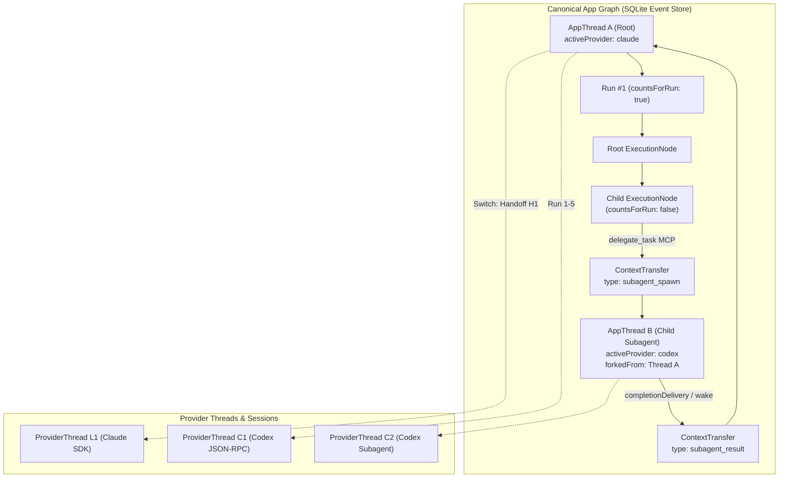
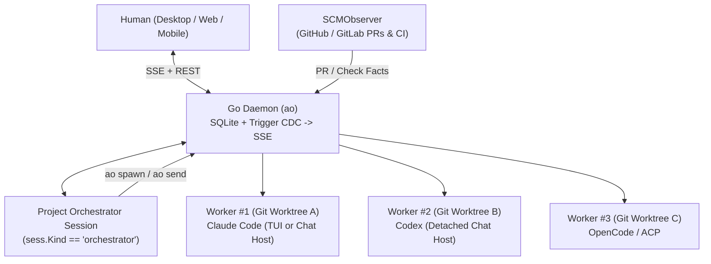

# Category 1: Multi-Harness GUIs & Parallel Agent Workspace Managers

> **Scope**: Systems that sit *above* coding-agent harnesses (Claude Code, Codex, Gemini CLI, OpenCode, Cursor Agent, Pi, Aider, Goose, etc.) and allow a human—or a meta-orchestrator agent—to spawn, switch, supervise, and hand off work across multiple parallel agents and workspaces.
>
> **Repositories Analyzed in `/Users/jack/workspace/orchestrator-architecture/repos/`**:
> `t3code`, `vibe-kanban`, `crystal`, `nimbalyst`, `claude-squad`, `sculptor`, `superset`, `emdash`, `agent-deck`, `agent-orchestrator`, `omnara`, `happy`, `terragon-oss`, `ccmanager`, `uzi`, plus closed-source **Conductor** (`conductor.build`).

---

## Table of Contents

1. [T3 Code (`pingdotgg/t3code`) — *Deep Dive: Orchestrator V2*](#1-t3-code-pingdotggt3code)
2. [Conductor (`conductor.build`)](#2-conductor-conductorbuild)
3. [Vibe Kanban (`BloopAI/vibe-kanban`)](#3-vibe-kanban-bloopaivibe-kanban)
4. [Crystal (`stravu/crystal`)](#4-crystal-stravucrystal)
5. [Nimbalyst (`nimbalyst/nimbalyst`)](#5-nimbalyst-nimbalystnimbalyst)
6. [Claude Squad (`smtg-ai/claude-squad`)](#6-claude-squad-smtg-aiclaude-squad)
7. [Sculptor (`imbue-ai/sculptor`)](#7-sculptor-imbue-aisculptor)
8. [Superset (`superset-sh/superset`)](#8-superset-superset-shsuperset)
9. [Emdash (`generalaction/emdash`)](#9-emdash-generalactionemdash)
10. [Agent Deck (`asheshgoplani/agent-deck`)](#10-agent-deck-asheshgoplaniagent-deck)
11. [Agent Orchestrator / Orchestrator.inc (`ComposioHQ/agent-orchestrator`)](#11-agent-orchestrator--orchestratorinc-composiohqagent-orchestrator)
12. [Omnara (`omnara-ai/omnara`)](#12-omnara-omnara-aiomnara)
13. [Happy Coder (`slopus/happy`)](#13-happy-coder-slopushappy)
14. [Terragon (`terragon-labs/terragon-oss`)](#14-terragon-terragon-labsterragon-oss)
15. [CCManager (`kbwo/ccmanager`)](#15-ccmanager-kbwoccmanager)
16. [Uzi (`devflowinc/uzi`)](#16-uzi-devflowincuzi)
17. [Cross-Product Comparison Matrix](#17-cross-product-comparison-matrix)
18. [Key Architectural Patterns & Synthesis](#18-key-architectural-patterns--synthesis)

---

## 1. T3 Code (`pingdotgg/t3code`)

### 1. What It Is / OSS Status / Repo URL
- **What it is**: An open-source, local-first desktop and web control plane for coding agents built by Theo Browne / Ping (`@t3tools`), featuring **Orchestrator V2**—an event-sourced, cross-provider runtime that separates the canonical application conversation graph from underlying provider sessions and allows both humans and agents to switch providers mid-thread or delegate subagent tasks across providers.
- **OSS Status**: Open Source (MIT License).
- **Repo URL**: `https://github.com/pingdotgg/t3code` (local clone: `repos/t3code`).
- **Tech Stack**: TypeScript monorepo (`apps/server`, `apps/web`, `apps/desktop`, `packages/contracts`, `packages/provider-core`, `packages/provider-cursor`, `packages/provider-opencode`, `packages/provider-grok`, `packages/provider-pi`, `packages/provider-acp-registry`), Effect-TS, SQLite (`statev2.sqlite`), WebSockets, and an embedded HTTP/ACP MCP server.

### 2. Topology & Hierarchy
T3 Code Orchestrator V2 (`repos/t3code/docs/orchestration-v2/core-graph-and-data-model.md`, `repos/t3code/packages/contracts/src/orchestrationV2.ts`, `repos/t3code/apps/server/src/orchestration-v2/Orchestrator.ts`) implements a **hybrid human-supervised + agent-driven hierarchical execution graph** with two orthogonal trees:

1. **Thread Lineage Tree (`AppThread` -> `AppThread`)**:
   - Every user-visible or delegated conversation is an `AppThread` (`OrchestrationV2ThreadProjection`).
   - A thread can be created standalone, forked by a user (`forkedFrom`), or spawned as an **app-owned subagent thread** by a parent agent calling the `delegate_task` MCP tool (`dispatchDelegatedTaskRequest` in `repos/t3code/apps/server/src/orchestration-v2/Orchestrator.ts:6596-6900`).
   - Lineage edges are tracked as `ContextTransfer` records (`type: "fork" | "provider_switch" | "merge_back" | "subagent_spawn" | "subagent_result"`).

2. **Intra-Run Execution Node Tree (`AppThread -> Run -> RunAttempt -> ExecutionNode`)**:
   - Each user turn creates a `Run` (counted user-visible turn) and a `RunAttempt`.
   - Inside a `RunAttempt`, work executes as a tree of `ExecutionNode`s (`parentNodeId`).
   - **Rule (`countsForRun`)**: Only the root execution node has `countsForRun: true` and advances the thread's run counter. Child execution nodes (whether native provider subagents like Claude Code's `Task` tool mapped by `ClaudeAdapterV2.ts` or app-owned delegated threads) have `countsForRun: false` so child completion never prematurely closes the parent run (`repos/t3code/docs/orchestration-v2/core-graph-and-data-model.md`).

3. **Depth & Privilege Limits (Capability Ceiling instead of Fixed Depth)**:
   - Unlike systems with a hard integer recursion limit, T3 Code enforces a **monotonic privilege ceiling** (`repos/t3code/docs/orchestration-v2/orchestrator-mcp-server.md`): a child thread spawned via `delegate_task` or `t3_thread_launch` **cannot run with a broader `runtimeMode`** (`approval-required` < `auto-accept-edits` < `full-access`) than its caller. If the caller omits `runtimeMode`, the child inherits the caller's mode (or steps down to the broadest mode the target provider supports).



### 3. Information Passing & Context Handoff
T3 Code has the most rigorous cross-provider context handoff architecture of any open-source orchestrator. It uses **three distinct mechanisms** depending on whether the transition is a **mid-thread provider switch**, an **agent-to-subagent delegation**, or an **on-demand history inspection**:

#### A. Mid-Thread Cross-Provider Handoff (`ContextHandoffService` & `handoffBudget.ts`)
When a user (or orchestrator) switches a thread's provider mid-conversation (e.g., from Codex to Claude, or Claude to OpenCode/Pi/Cursor), T3 Code does **not** use a lossy LLM summary. Instead, it materializes a deterministic, token-budgeted `ContextHandoff` artifact (`repos/t3code/apps/server/src/orchestration-v2/ContextHandoffService.ts`, `repos/t3code/apps/server/src/orchestration-v2/ProviderSwitchService.ts`, `repos/t3code/packages/provider-core/src/server/handoffBudget.ts`):

- **Token & Byte Budgeting (`handoffBudget` in `repos/t3code/packages/provider-core/src/server/handoffBudget.ts:88-115`)**:
  - Uses pessimistic UTF-8 byte accounting: **1 UTF-8 byte = 1 token**.
  - Attachments reserve fixed allowances (`attachmentTokenAllowance`: `8,192` tokens for images, `4,096` tokens for non-image files).
  - Reserves `max(16_000, ceil(modelContextWindowTokens / 4))` tokens for system instructions, tool schemas, and the upcoming turn.
  - Clamps the handoff budget to `T3CODE_CONTEXT_HANDOFF_TOKEN_CAP` (default `16,000` tokens, range `1,024..64,000`) and `HANDOFF_BYTE_CAP = 64,000` bytes.
- **Deterministic Priority Selection (`selectHistory` in `handoffBudget.ts:217-263`)**:
  - Messages are selected into the budget in strict priority order so the receiving provider never loses the current prompt or original goal:
    1. **Latest user message** (`findLastIndex(m => m.role === "user")`)
    2. **Latest assistant message** (`findLastIndex(m => m.role === "assistant")`)
    3. **First user message** (`findIndex(m => m.role === "user")` — preserves original task constraints)
    4. **Reverse chronological walk** from `messages.length - 1` down to `0` for all remaining messages that fit the remaining token and byte budget.
- **Structured Attribution Header (`renderHistoricalMessage` in `handoffBudget.ts:127-166`)**:
  - Every transferred message is tagged with full provenance:
    ```text
    [Historical user; message; thread=thr_123; run=run_4; item=itm_9; provider-thread=pth_codex_1; status=completed; run-status=completed]
    ```
- **Self-Service Recovery Pointer (`handoffCoverage` in `handoffBudget.ts:265-275`)**:
  - If earlier turns were omitted due to the 16k token cap, the handoff header explicitly lists `selectedMessageCount`, `omittedMessageCount`, and the exact omitted item range (`firstOmittedItemId` .. `lastOmittedItemId`), instructing the target agent:
    > *"Use `t3_thread_read` with `threadId=\"...\"`, `view=\"activity\"`, `limit=20`, `maxCharsPerItem=4000`, and `afterPosition` / `textOffset` as needed if you need omitted project history before acting."*
- **Delta Handoff on Return (`deliverContextHandoffs` in `repos/t3code/apps/server/src/orchestration-v2/ContextHandoffDelivery.ts:75-185`)**:
  - If Thread A runs Turns 1–5 on Codex (`ProviderThread C1`), switches to Claude (`ProviderThread L1`) for Turns 6–8 (`Handoff H1` carries 1–5), and switches **back** to Codex for Turn 9: T3 Code **resumes the existing Codex thread `C1`** and tracks `alreadyDeliveredItemIds` across previous handoffs so `Handoff H2` injects **only the delta (Turns 6–8)** that happened while away on Claude (`repos/t3code/docs/orchestration-v2/provider-switching-and-context.md`).
- **Adapter-Specific Injection (`ContextHandoffDelivery.ts`, `ProviderTurnStartService.ts:1140`)**:
  - **Codex (`CodexAdapterV2.ts:6612`)**: Implements `session.injectHistory`, calling Codex App Server JSON-RPC `thread/inject_items` (`historyResponseItems`) to insert structured native `user` and `assistant` conversation items directly into the Codex thread before `turn/start` (with automatic fallback to inline text if the server returns `-32601`).
  - **Claude (`ClaudeAdapterV2.ts`), OpenCode, Cursor, Pi, Grok, ACP**: Omit `injectHistory`; `deliverContextHandoffs` renders the portable transcript via `renderHistory()` and prepends it as `inlineText` on the outgoing prompt.
  - **Crash-Safe Delivery State Machine**: Each handoff tracks `delivery.status` (`"pending"` -> `"delivered"`, or `"unsent"` on pre-read rejection) so crashed turns never double-inject history on retry.

#### B. Parent-to-Subagent Delegation (`delegate_task` & `NotificationMailbox`)
- Registered via the embedded HTTP MCP server (`http://127.0.0.1:<port>/mcp`, `repos/t3code/apps/server/src/mcp/toolkits/orchestrator/tools.ts`) and ACP CLI script fallback.
- When a parent agent invokes `delegate_task({ task, providerInstanceId, model, role, isolation, mode, timeoutMs })`:
  - **No parent transcript bloat**: Parent history is intentionally **not** copied into the child thread (`repos/t3code/docs/orchestration-v2/orchestrator-mcp-server.md`). The child receives a clean context window containing only the `task` prompt and optional `role` instruction (with `t3_thread_read` available if it needs to inspect parent history).
  - **Completion Delivery & Parent Wake (`planDelegatedCompletionDelivery` in `Orchestrator.ts:9925-10320`, `NotificationMailbox.ts`)**:
    - Tracks child result delivery via `completionDelivery.state`: `"pending"` -> `"offered"` -> `"delivered"` -> `"acknowledged"` | `"disposed"`.
    - When an `async` child finishes: if the parent turn is currently active and the parent adapter supports mid-turn steering, the result notification is steered into the running turn; if the parent thread is idle, `Orchestrator.ts` **automatically dispatches a system wake run** on the parent thread containing the child's final output and `ContextTransfer` (`type: "subagent_result"`).

### 4. Agent Lifespan & Context Window Management
- **Separation of `AppThread`, `ProviderThread`, and `ProviderSession`**:
  - `AppThread` is durable forever in SQLite (`statev2.sqlite`).
  - `ProviderThread` represents the provider-side conversation (`nativeThreadRef`, e.g., Claude SDK `sessionId` or Codex `threadId`).
  - `ProviderSession` (`ProviderSessionManager` in `repos/t3code/apps/server/src/orchestration-v2/ProviderSessionManager.ts`) manages live runtime processes. Sessions can detach (`provider-session.detach`), hibernate, and resume on the next turn via `resumeCursor` / `nativeThreadRef`.
- **Context Compaction & Rollback**:
  - Tracks live token usage and context window fill in `ProviderThread` state (`contextWindowTokens`, `usedTokens`).
  - Supports mid-thread compaction events (`context_compaction` execution nodes) and provider-thread rollback (`provider-thread.rollback` in `EffectOutbox.ts`), including Claude SDK's `resumeSessionAt` and `forkSession` (`repos/t3code/apps/server/src/orchestration-v2/ClaudeAdapterV2.ts:1680-1715`).

### 5. Fast vs Slow / Model Mixing & Cross-Provider Support
- **Built-in V2 Provider Adapters (`repos/t3code/apps/server/src/orchestration-v2/builtInProviderAdapterDrivers.ts`)**:
  1. `CodexAdapterV2Driver` (OpenAI Codex App Server JSON-RPC)
  2. `ClaudeAdapterV2Driver` (`@anthropic-ai/claude-agent-sdk`)
  3. `CursorAdapterV2Driver` (`@t3tools/provider-cursor`)
  4. `OpenCodeAdapterV2Driver` (`@t3tools/provider-opencode`, supporting OpenCode 2.x)
  5. `GrokAdapterV2Driver` (`@t3tools/provider-grok`)
  6. `PiAdapterV2Driver` (`@t3tools/provider-pi`, supporting Pi 1.0)
  7. `AcpRegistryAdapterV2Driver` (`@t3tools/provider-acp-registry` for arbitrary ACP agents)
  8. Additional adapters in `apps/server/src/orchestration-v2/`: `AntigravityAdapterV2.ts`, `MuseAdapterV2`.
- **Declarative Provider Capability System (`repos/t3code/docs/orchestration-v2/provider-capability-system.md`)**:
  - Every adapter declares a structured `OrchestrationV2ProviderCapabilities` matrix across 11 domains (`sessions`, `threads`, `turns`, `streaming`, `tools`, `approvals`, `planning`, `subagents`, `context`, `checkpointing`, `identity`).
- **Agent-Driven Cross-Provider Mixing**:
  - An agent calls `orchestrator_capabilities` (`repos/t3code/apps/server/src/mcp/toolkits/orchestrator/tools.ts:80-130`) to discover all configured `providerInstances`, their available models, reasoning effort levels, and capabilities, and then calls `delegate_task` to route sub-tasks to specific providers/models (e.g., Claude Opus 4.6 orchestrating a Codex GPT-5.4 worker for backend refactoring and a fast model for codebase search).

### 6. Human-in-the-Loop & Quality Gates
- **Unified Runtime Requests (`RuntimeRequestRecord` in `Orchestrator.ts`)**:
  - Normalizes tool approvals (`approval`), structured user questions (`user-input`), and plan reviews across all providers into durable `RuntimeRequest` records stored in SQLite and resolved via `runtime-request.respond` outbox effects.
- **Git-Ref Checkpointing (`repos/t3code/apps/server/src/checkpointing/CheckpointStore.ts`, `CheckpointRestoreSafety.ts`)**:
  - Captures hidden Git refs (`checkpointRefForScopeOrdinal`) per `CheckpointScope` before/after turns.
  - Root-run checkpoints advance the user-visible checkpoint timeline; subagent checkpoints are nested so they do not pollute parent run ordinals.
  - Restoring a checkpoint atomically rolls back both the git working tree (`CheckpointRestoreSafety.ts`) and the provider conversation cursor (`provider-thread.rollback`).
- **Worktree Handoff (`t3_worktree_handoff` in `tools.ts`)**:
  - Previews (`dry_run`), checks dirty status, and merges or cherry-picks an isolated child worktree back into the parent checkout.

### 7. Persistence, Memory, Learning Across Sessions
- **Event-Sourced SQLite Core (`statev2.sqlite`)**:
  - `EventStore.ts` (`repos/t3code/apps/server/src/orchestration-v2/EventStore.ts`) stores the immutable log of `OrchestrationV2DomainEvent`s with store-assigned monotonic `sequence` numbers.
  - `CommandReceiptStore.ts` provides idempotent command deduplication and replay (`canReplayCommandReceipt`).
  - `ProjectionStore.ts` maintains materialized read models (`OrchestrationV2ThreadProjection`, `OrchestrationV2WorkspaceProjection`). WebSocket clients sync via snapshot at `sequence N` + live tail of events `> N`.
  - `EffectOutbox.ts` persists pending runtime side effects (`OrchestrationEffectRequestV2`) so server restarts never drop in-flight turns, interrupts, or handoffs.

### 8. Notable Design Insights
1. **Deterministic Token-Budgeted Handoff + Self-Service Pull (`selectHistory` + `t3_thread_read`)**: Instead of summarizing a 100k-token transcript with an LLM (which loses exact stack traces, file paths, and constraints), T3 Code deterministically packs the first user prompt, latest user/assistant exchange, and reverse-chronological history into a 16k-token budget, then gives the receiving agent a pagination cursor to pull omitted items via MCP (`t3_thread_read`) only if needed.
2. **Delta-Only Handoffs When Switching Back (`alreadyDeliveredItemIds`)**: Preserving the dormant `ProviderThread` per provider and only injecting the delta of messages generated on *other* providers eliminates quadratic context growth during ping-pong provider switching.
3. **`countsForRun: false` on Subagent Execution Nodes**: Decouples subagent execution lifecycles from user-visible turn accounting while keeping all subagent activity inside the same event-sourced audit graph.

---

## 2. Conductor (`conductor.build`)

### 1. What It Is / OSS Status / Repo URL
- **What it is**: A native macOS application and cloud workspace orchestrator built by Melty Labs that lets developers run, supervise, review, and coordinate fleets of parallel **Claude Code**, **Codex**, and **Cursor** agents across isolated Git worktrees or cloud Firecracker microVMs.
- **OSS Status**: Closed Source / Proprietary (free local macOS tier using user's existing Claude/Codex credentials; paid Pro/Team cloud workspace tiers).
- **Website**: `https://www.conductor.build` (`https://docs.conductor.build`).

### 2. Topology & Hierarchy
- **Primary Topology**: **Human-as-Tech-Lead over Parallel Worktree Workspaces** (`1 Workspace = 1 Git Branch + 1 Git Worktree` stored under `~/conductor/workspaces/<repo>/<workspace-name>`), augmented by **Multi-Agent Collaboration** within and across workspaces (introduced in v0.37+).
- **Spawning Model**:
  - The human spawns N parallel workspaces from repository branches, GitHub PRs, or Linear issues.
  - Inside a workspace, a user or lead agent can spawn additional agent tabs or sub-tasks that collaborate on the same branch or across isolated workspaces.
  - Exposes a local HTTP API and MCP server so external tools or orchestrator agents can programmatically launch and query workspaces.

### 3. Information Passing & Context Handoff
- **Workspace Context & Archive Scripts**:
  - Because Git worktrees do not track ignored files (`.env`, local SQLite DBs, build caches), Conductor introduces a 3-hook workspace lifecycle: **Setup Script** (runs on worktree creation to symlink/copy `.env` and install deps), **Run Script** (starts dev server), and **Archive Script** (cleans up resources).
- **Cross-Agent Context Sharing**:
  - Uses explicit `@file`, `@branch`, and workspace context attachments plus native `.claude/` skills/commands and `.context/` markdown handoff artifacts.
  - When switching between Claude Code and Codex inside a workspace, agents share the live Git worktree state, uncommitted diff, and workspace notes/checklists.

### 4. Agent Lifespan & Context Window Management
- **Local vs. Cloud Lifespan**:
  - **Local Workspaces**: Run local Claude Code / Codex processes on macOS; persist transcripts on disk and resume across app restarts.
  - **Cloud Workspaces (Vercel-backed Firecracker microVMs)**: Full Linux VMs with snapshot/resume that keep long-running agent loops alive even when the user closes their MacBook or switches to the Conductor iPhone app.
- **Context Meter & Compaction**: Displays live context-window utilization per agent tab and triggers native `/compact` or fresh-tab continuation when context approaches capacity.

### 5. Fast vs Slow / Model Mixing & Cross-Provider Support
- **Supported Harnesses**: **Claude Code** (Opus 4.6, Sonnet 4.6, Haiku 4.5), **OpenAI Codex** (GPT-5.4, o3/codex variants), and **Cursor Agent**.
- **Model Mixing Pattern**: Users routinely assign planning or complex architecture to one model/provider, implementation to another, and spawn a second agent in the same workspace specifically as an adversarial **PR Reviewer / Test Runner** before opening a GitHub PR.

### 6. Human-in-the-Loop & Quality Gates
- **Turn-by-Turn Diff Viewer & Inline Review**: Built-in side-by-side Git diff inspector where humans leave inline comments directly on changed lines to steer the agent's next turn.
- **Automated Checks & Spotlight Testing**: Integrates local test suites, linters, and GitHub Actions CI checks directly into the workspace status bar, with 1-click "Fix failing checks" handoff back to the agent.
- **Multiplayer URLs (`Cmd+Shift+C`)**: Generates live shareable links so teammates can inspect or co-drive an agent session and its worktree diff in real time.

### 7. Persistence, Memory, Learning Across Sessions
- Stores workspace metadata, conversation transcripts, setup/run/archive scripts, and reusable prompt templates locally and syncs cloud workspace state across macOS and iOS.
- Supports repository-checked-in configuration (`conductor.json` / `.claude/`) so setup scripts and team conventions persist in Git.

### 8. Notable Design Insights
1. **Worktree Setup Script as a First-Class Primitive**: Conductor popularized the insight that `git worktree add` alone is unusable for real apps without automated `.env` / `node_modules` / port provisioning hooks.
2. **Seamless Local-to-Cloud VM Continuum**: Running lightweight interactive tasks locally on macOS while offloading heavy background refactors to Firecracker microVMs under the exact same worktree/diff UI.

---

## 3. Vibe Kanban (`BloopAI/vibe-kanban`)

### 1. What It Is / OSS Status / Repo URL
- **What it is**: An open-source Kanban board and multi-harness orchestration server built by BloopAI that turns tasks/issues into isolated multi-repo Git worktrees executed by 10+ coding-agent harnesses, complete with a scoped **Orchestrator MCP Server** so an agent can manage other agent sessions. *(Note: Repo README announces hosted service sunsetting late 2026 while the full Rust/TS codebase remains Apache-2.0).*
- **OSS Status**: Open Source (Apache-2.0 License).
- **Repo URL**: `https://github.com/BloopAI/vibe-kanban` (local clone: `repos/vibe-kanban`).
- **Tech Stack**: Rust workspace (`crates/server`, `crates/executors`, `crates/db`, `crates/mcp`, `crates/workspace-manager`, `crates/worktree-manager`, `crates/review`) + React/TypeScript frontend + Tauri desktop wrapper.

### 2. Topology & Hierarchy
Vibe Kanban supports both a **Human-Driven Kanban Topology** and an **Agent-Driven 2-Tier Orchestrator -> Session Hierarchy**:
- **Data Hierarchy (`repos/vibe-kanban/crates/db/src/models/`)**:
  - `Project` -> `Issue` / `Task` -> `Workspace` (`workspace.rs`, supporting **multi-repo worktrees** via `workspace_repo.rs`) -> multiple `Session`s (`session.rs`, each bound to an `executor` harness) -> `CodingAgentTurn` (`coding_agent_turn.rs`) & `ExecutionProcess` (`execution_process.rs`).
- **Dual-Mode MCP Server (`repos/vibe-kanban/crates/mcp/src/task_server/mod.rs`)**:
  1. **`global_mode_router`**: Exposes project/issue/workspace CRUD (`list_workspaces`, `start_workspace`, `create_issue`, etc.) to an external top-level client.
  2. **`orchestrator_mode_router`**: Automatically injected into an orchestrator agent running *inside* a workspace (`orchestrator_session_id`). Exposes `create_session`, `list_sessions`, `update_session`, `run_session_prompt`, and `get_execution` (`repos/vibe-kanban/crates/mcp/src/task_server/tools/sessions.rs`).
- **Who Spawns Whom**: An orchestrator session inside a workspace can spawn sibling/child `Session`s on **any configured executor** (`CreateSessionRequest { workspace_id, executor, name }`), dispatch prompts asynchronously (`run_session_prompt`), and poll their completion (`get_execution`).

### 3. Information Passing & Context Handoff
- **Cross-Executor Session Handoff via MCP (`repos/vibe-kanban/crates/mcp/src/task_server/tools/sessions.rs:140-310`)**:
  - `run_session_prompt` starts an execution process in the target session and returns `RunCodingAgentInSessionResponse { execution_process_id, session_id }`.
  - When the orchestrator calls `get_execution({ execution_process_id })`, the server queries `CodingAgentTurn::find_by_execution_process_id` and returns `GetExecutionResponse` containing the child agent's extracted **`final_message` (`summary`)**, `status`, and `exit_code`.
  - Because all sessions in the same `Workspace` share the same `workspace_dir` (and its multi-repo Git worktrees), code changes made by Session A (e.g., Claude Code) are immediately visible on disk to Session B (e.g., Codex or Gemini CLI).
- **Normalized Log Stream (`repos/vibe-kanban/crates/executors/src/logs/`)**:
  - Every executor parses harness-specific stdout/JSONL into canonical `NormalizedEntry` structs (`UserMessage`, `AssistantMessage`, `ToolUse`, `ToolResult`, `Thinking`, `ErrorMessage`) persisted in `execution_process_logs.rs`.

### 4. Agent Lifespan & Context Window Management
- **Ephemeral Process per Turn with Native Session Resume (`repos/vibe-kanban/crates/executors/src/actions/coding_agent_follow_up.rs`)**:
  - Agents run as per-turn child processes (`Command::new` via `command-group`).
  - On follow-up turns, `CodingAgentFollowUpRequest` invokes `spawn_follow_up(&effective_dir, &prompt, &session_id, reset_to_message_id, env)` on the `StandardCodingAgentExecutor` trait (`repos/vibe-kanban/crates/executors/src/executors/mod.rs:115-155`), passing the provider's native session ID (e.g. `claude --resume <id>`).
- **Message-Level Time-Travel Reset (`reset_to_message_id` + `execution_process_repo_state.rs`)**:
  - Before and after every `ExecutionProcess`, Vibe Kanban records the exact Git HEAD commit SHA per repository in `execution_process_repo_state` (`before_head_commit`, `after_head_commit`). Users can rewind a session to any prior turn, resetting both the Git worktree commits and the agent's conversation pointer.

### 5. Fast vs Slow / Model Mixing & Cross-Provider Support
- **10 Built-in Executor Harnesses (`repos/vibe-kanban/crates/executors/src/executors/`)**:
  - `claude.rs` (Claude Code), `codex.rs` (OpenAI Codex), `gemini.rs` (Gemini CLI), `amp.rs` (Sourcegraph Amp), `cursor.rs` (Cursor Agent), `copilot.rs` (GitHub Copilot CLI), `droid.rs` (Factory Droid), `opencode.rs` (OpenCode), `qwen.rs` (Qwen Code), and `acp/` (generic Agent Client Protocol adapter).
- **Executor Profiles (`repos/vibe-kanban/crates/executors/src/profile.rs`)**:
  - Profiles define harness + model + flags (e.g., `CLAUDE_CODE:PLAN`, `CODEX:HIGH`, `GEMINI:FLASH`), allowing different Kanban columns or sub-sessions inside a workspace to run different providers.

### 6. Human-in-the-Loop & Quality Gates
- **Approval Service (`repos/vibe-kanban/crates/executors/src/approvals.rs`)**:
  - Bridges tool-execution permission prompts from executors (such as Claude Code control protocol and ACP permission requests) to the web/desktop UI via `ExecutorApprovalService`.
- **Built-in Diff & Automated Review Action (`repos/vibe-kanban/crates/executors/src/actions/review.rs`, `crates/review/`)**:
  - Dedicated `ReviewRequest` action that runs an agent specifically to review the workspace diff against the base branch, plus an integrated diff viewer and dev-server preview pane.

### 7. Persistence, Memory, Learning Across Sessions
- **SQLite Database (`crates/db/migrations/`)**: Persists projects, workspaces, multi-repo worktree mappings, sessions, turns, normalized JSONL execution logs, and per-turn git commit states (`execution_process_repo_state`).

### 8. Notable Design Insights
1. **Scoped `orchestrator_mode_router` MCP**: By binding an MCP server instance to a specific `workspace_id` and `orchestrator_session_id`, any standard coding agent (Claude, Codex, etc.) becomes a multi-harness orchestrator capable of spawning and polling specialist sessions on other providers (`create_session` + `run_session_prompt` + `get_execution`) without custom SDK changes.
2. **Multi-Repo Worktree Atomic State (`execution_process_repo_state`)**: Recording `before_head_commit` and `after_head_commit` across multiple linked repositories per turn makes cross-repo agent rollback deterministic.

---

## 4. Crystal (`stravu/crystal`)

### 1. What It Is / OSS Status / Repo URL
- **What it is**: An Electron desktop multi-session manager for running parallel **Claude Code** and **Codex** sessions in isolated Git worktrees, featuring a deterministic SQLite-backed context compactor and an IPC permission bridge. *(Rebranded and expanded into **Nimbalyst** in February 2026; see Section 5).*
- **OSS Status**: Open Source (MIT License).
- **Repo URL**: `https://github.com/stravu/crystal` (local clone: `repos/crystal`).
- **Tech Stack**: Electron, TypeScript, React, `better-sqlite3`, `node-pty`.

### 2. Topology & Hierarchy
- **Flat Parallel Worktree Sessions (`repos/crystal/main/src/services/sessionManager.ts`, `worktreeManager.ts`)**:
  - Human acts as the central orchestrator spawning parallel sessions organized into Project Folders.
  - Each session is backed by an isolated Git worktree (`worktreeManager.ts`) and managed by `AbstractCliManager` (`repos/crystal/main/src/services/panels/cli/abstractCliManager.ts`) instantiated via `cliManagerFactory.ts` (`claudeCodeManager.ts` or `codexManager.ts`).
  - Within a session, the user can open multiple panels (`claude`, `codex`, `diff`, `terminal`, `editor`, `logs`, `dashboard`).

### 3. Information Passing & Context Handoff
- **Programmatic Deterministic Context Compactor (`repos/crystal/main/src/utils/contextCompactor.ts`)**:
  - When a session's context grows too large or the user continues/hands off work, `ProgrammaticCompactor.generateSummary(sessionId, data)` synthesizes a structured Markdown handoff summary **directly from SQLite records without calling an LLM**:
    - Reads `Session`, `PromptMarker[]` (every user prompt, completion timestamp, and exit status), `ExecutionDiff[]` (every git diff stat and changed file list per turn), `SessionOutput[]` (parsed JSON messages and tool calls), and `Todo[]` (extracted task checklists).
    - Detects whether the last prompt was interrupted while running (`wasInterrupted`), lists all modified files (`<file_modifications>`), reconstructs the chronological task log, and emits a clean continuation prompt.

### 4. Agent Lifespan & Context Window Management
- **Per-Prompt CLI Execution with `--resume` (`repos/crystal/main/src/services/panels/cli/claudeCodeManager.ts`)**:
  - Spawns the CLI process per turn/session and tracks the native agent session ID in SQLite (`claude_session_id`) to resume conversations across app restarts.
  - When context fills up, users trigger `ProgrammaticCompactor` to start a fresh underlying agent session pre-seeded with the deterministic SQLite summary.

### 5. Fast vs Slow / Model Mixing & Cross-Provider Support
- **Supported Harnesses (`repos/crystal/main/src/services/panels/cli/cliManagerFactory.ts`)**:
  - **Claude Code** (`claudeCodeManager.ts`) and **OpenAI Codex** (`codexManager.ts`), selectable per session or panel with per-panel model configuration.

### 6. Human-in-the-Loop & Quality Gates
- **Stdio MCP -> Unix Socket Permission Bridge (`repos/crystal/main/src/services/mcpPermissionBridge.ts`, `permissionIpcServer.ts`)**:
  - Crystal injects a tiny Node stdio MCP server (`mcpPermissionBridge.js <sessionId> <ipcSocketPath>`) into Claude Code via `--mcp-config`.
  - When Claude requests permission to run a tool (`approve_permission`), the MCP bridge sends a JSON packet over a local Unix domain socket / Windows named pipe to `PermissionIpcServer` in the Electron main process, which pops a native approval modal in the UI and blocks the tool call until the user approves or denies.
- **Per-Turn Diff Capture (`executionDiff` table)**: Captures git diffs after every prompt and provides a visual rebase/squash/merge workflow back to the main branch.

### 7. Persistence, Memory, Learning Across Sessions
- **SQLite (`repos/crystal/main/src/database/database.ts`, `models.ts`)**: Stores `projects`, `sessions`, `session_outputs`, `prompt_markers`, `execution_diffs`, `todos`, and `tool_panels`.

### 8. Notable Design Insights
1. **Zero-LLM SQLite Compaction (`ProgrammaticCompactor`)**: Because the orchestrator already records every prompt, tool call, todo item, and per-turn git diff in SQLite, it can generate a high-fidelity continuation prompt instantaneously and for $0 without waiting on a summarization model.
2. **Out-of-Band MCP Permission Socket (`mcpPermissionBridge.ts`)**: Using a lightweight stdio MCP binary that proxies to an Electron Unix socket cleanly decouples CLI stdout parsing from interactive tool approval.

---

## 5. Nimbalyst (`nimbalyst/nimbalyst`)

### 1. What It Is / OSS Status / Repo URL
- **What it is**: The February 2026 evolution and rebrand of Crystal (`stravu/crystal`) into a full local-first **multi-harness WYSIWYG workspace, document/diagram editor, and parallel session orchestrator** with mobile companion apps and a collaborative CRDT runtime.
- **OSS Status**: Open Source (MIT License for the open-source core/extensions).
- **Repo URL**: `https://github.com/nimbalyst/nimbalyst` (local clone: `repos/nimbalyst`).
- **Tech Stack**: TypeScript monorepo (`packages/core`, `packages/runtime`, `packages/markdown-ydoc`, `packages/collab-protocol`, `packages/extension-sdk`, `packages/mcp-FromNimbalyst`, `packages/extensions`, `packages/web`, `packages/ios`, `packages/android`).

### 2. Topology & Hierarchy
- **Human + Crew Multi-Harness Workspace Topology**:
  - Expands Crystal's parallel session/worktree model with a Kanban **Session Board** (filtering sessions by status, tags, worktrees, and projects) and the **`crew` extension (`repos/nimbalyst/packages/extensions/crew/`)** plus **`planning` extension (`repos/nimbalyst/packages/extensions/planning/`)** for structured multi-agent workflows.
  - Supports running **Claude Code, OpenAI Codex, OpenCode, GitHub Copilot CLI, and Gemini CLI** side-by-side against shared local Markdown plans, Mermaid/Excalidraw diagrams, HTML mockups, and code files.

### 3. Information Passing & Context Handoff
- **Bidirectional Markdown <-> Yjs CRDT Document Bus (`repos/nimbalyst/packages/markdown-ydoc/`, `packages/collab-protocol/`, `packages/runtime/`)**:
  - Unlike chat-only orchestrators where handoffs happen via terminal text, Nimbalyst uses **structured Markdown files on disk synchronized in real time with a Yjs CRDT document model (`markdown-ydoc`)** as the shared state medium between the human and multiple agents.
  - When any agent edits a plan, spec, data model, or code file on disk, Nimbalyst parses the edit into the live Yjs document and highlights agent changes inline (`ai-diff-tracker`).
- **Context Attachments & Compaction**:
  - Retains Crystal's deterministic session compaction and adds `@file`, `@selection`, and visual element context injection across all 5 supported CLI harnesses.

### 4. Agent Lifespan & Context Window Management
- Long-lived resumable sessions persisted locally with live context-window tracking, session status indicators (`Working`, `Waiting for Input`, `Idle`, `Completed`), and session-to-session continuation.

### 5. Fast vs Slow / Model Mixing & Cross-Provider Support
- **Supported Harnesses**: **Claude Code**, **OpenAI Codex**, **OpenCode** (connecting to 75+ providers including Ollama, Groq, OpenRouter), **GitHub Copilot**, and **Gemini CLI**.
- Users can switch providers/models per session or use one provider for spec/mockup authoring and another for code execution.

### 6. Human-in-the-Loop & Quality Gates
- **Inline Red/Green Diff Approval Bar (`repos/nimbalyst/packages/runtime/src/plugins/DiffApprovalBar/`)**:
  - Every agent edit to a plan, document, or code file renders inline green additions and red strikethrough deletions with per-hunk and per-document **Accept / Reject** buttons directly in the editor.

### 7. Persistence, Memory, Learning Across Sessions
- **`nimbalyst-memory` Extension (`repos/nimbalyst/packages/extensions/nimbalyst-memory/`)**:
  - Dedicated memory extension that indexes session histories, decisions, and project artifacts so future sessions across any harness can query prior architectural context.
- **Cross-Device Sync (`packages/collab-protocol`, `packages/ios`, `packages/android`)**:
  - Syncs sessions and documents to iOS and Android companion apps so users can review agent diffs and steer sessions remotely.

### 8. Notable Design Insights
1. **Shared CRDT Artifacts (`markdown-ydoc`) as the Inter-Agent Bus**: Treating plans, specs, and diagrams as collaborative Yjs-backed Markdown documents with hunk-level accept/reject (`DiffApprovalBar`) turns "context handoff" from an opaque prompt copy into a human-curated shared specification.

---

## 6. Claude Squad (`smtg-ai/claude-squad`)

### 1. What It Is / OSS Status / Repo URL
- **What it is**: A lightweight Go terminal user interface (TUI) built with Bubble Tea that manages multiple parallel terminal coding agents (**Claude Code, Codex, Gemini CLI, OpenCode, Aider**) inside isolated `tmux` sessions and `git worktree` directories.
- **OSS Status**: Open Source (AGPL-3.0 License).
- **Repo URL**: `https://github.com/smtg-ai/claude-squad` (local clone: `repos/claude-squad`).
- **Tech Stack**: Go (`app/`, `session/`, `session/tmux/`, `session/git/`, `daemon/`), Bubble Tea (`charmbracelet/bubbletea`), `tmux`, `git worktree`.

### 2. Topology & Hierarchy
- **Flat Human-Managed Hub-and-Spoke (`repos/claude-squad/session/instance.go`, `app/app.go`)**:
  - The human operator uses a two-pane TUI (left: list of `Instance`s; right: live `tmux capture-pane` preview or `git diff` tab) to spawn, attach, pause, resume, and merge independent peer agents.
  - Agents do not spawn child agents through Claude Squad; each `Instance` owns 1 `tmux.Session` (`session/tmux/tmux.go`) and 1 `git.Worktree` (`session/git/worktree.go`).

### 3. Information Passing & Context Handoff
- **Pure Terminal + Git Branch State (`repos/claude-squad/session/instance.go`)**:
  - There is no structured JSON/MCP message bus between instances.
  - Initial task context is injected into the agent's PTY via `tmux send-keys` (`Instance.Start()`).
  - Cross-agent integration happens strictly through Git branches (`Checkout` / `Push` / PR creation).

### 4. Agent Lifespan & Context Window Management
- **Disk-Saving Pause/Resume Worktree Lifecycle (`repos/claude-squad/session/instance.go:423-570`)**:
  - **Active**: Runs inside a detached `tmux` session in `~/.claude-squad/worktrees/<branch>`.
  - **`Pause()` (`instance.go:467-512`)**:
    1. Checks `i.gitWorktree.IsDirty()`. If dirty, stages all files and commits a WIP snapshot: `[claudesquad] update from '<Title>' on <Date> (paused)`.
    2. Kills the `tmux` process (`i.tmuxSession.Kill()`) and **deletes the physical git worktree directory (`i.gitWorktree.Remove()` + `Prune()`)** while preserving the Git branch ref!
  - **`Resume()` (`instance.go:514-568`)**:
    1. Recreates the git worktree from the saved branch (`i.gitWorktree.Reset()`).
    2. Respawns the `tmux` session and restarts the agent CLI.

### 5. Fast vs Slow / Model Mixing & Cross-Provider Support
- **Custom Program Flag (`-p` / `program` in `session/instance.go`)**:
  - Supports `claude`, `codex`, `gemini`, `opencode`, `aider`, or any custom CLI command per instance.

### 6. Human-in-the-Loop & Quality Gates
- **Interactive Attach (`Enter`) vs. Background Auto-Yes Daemon (`repos/claude-squad/daemon/daemon.go`)**:
  - Humans can attach directly to any `tmux` session (`tmux attach-session`), review live diffs (`Tab` key toggles between terminal output and `git diff`), or run with `--autoyes`.
  - When `--autoyes` is enabled, `daemon.go` polls `tmux capture-pane`, hashes screen contents (`HasUpdated()`), runs `CheckAndHandleTrustPrompt()`, and sends approval keystrokes via `tmux send-keys`.

### 7. Persistence, Memory, Learning Across Sessions
- **JSON State File (`repos/claude-squad/session/storage.go`)**:
  - Persists instance metadata (`Title`, `Branch`, `Program`, `Status`: `Running`, `Paused`, `Ready`, `Loading`) in `~/.claude-squad/state.json`.

### 8. Notable Design Insights
1. **Ephemeral Worktree Directory / Persistent Branch (`Pause()` / `Resume()`)**: Deleting the worktree directory after auto-committing WIP to the branch solves one of the biggest pain points of worktree-based orchestrators: disk space explosion from dozens of duplicate build/dependency trees.

---

## 7. Sculptor (`imbue-ai/sculptor`)

### 1. What It Is / OSS Status / Repo URL
- **What it is**: An open-source multi-agent desktop GUI built by **Imbue** (`imbue.com`) for running parallel coding agents in isolated workspaces (Git worktrees, full clones, or containers), featuring first-class **Claude Code SDK** and **Pi (`pi.dev`)** harnesses, a side-channel `/btw` question service, an automated CI babysitter, and agent-driven context handoff/stacking skills.
- **OSS Status**: Open Source (MIT License — open-sourced in 2026).
- **Repo URL**: `https://github.com/imbue-ai/sculptor` (local clone: `repos/sculptor`).
- **Tech Stack**: Python backend (`sculptor/sculptor/`: FastAPI, asyncio, SQLite, `sculpt` CLI) + Electron/React/TypeScript frontend (`sculptor/frontend/`) + optional `openhost` container runtime (`openhost.Dockerfile`).

### 2. Topology & Hierarchy
Sculptor supports a **2-Level Workspace -> Multi-Agent Tab & Stacked-Workspace Hierarchy** (`repos/sculptor/docs/help/workspaces.md`, `repos/sculptor/sculptor/services/workspace_service/`):
- **Intra-Workspace Parallel Agents**: Multiple agent tabs can run simultaneously inside the **exact same workspace** sharing a working tree (e.g., Agent 1 implementing a feature while Agent 2 writes tests or answers a side question).
- **Inter-Workspace Parallelism & Stacking**: Multiple workspaces run in parallel per project using one of three isolation strategies:
  1. **Git Worktree (Default)**: Lightweight branch (`<user>/<slug>`) sharing `.git` objects.
  2. **Full Clone (`clone`)**: Completely independent `.git` directory cloned from the local repo.
  3. **In-Place (`inplace`)**: Operates directly on the user's primary checkout.
- **Agent-Driven Spawning via `sculpt` CLI (`repos/sculptor/sculptor/tools/sculpt/`)**:
  - Every agent process has `SCULPT_WORKSPACE_ID` and `SCULPT_PROJECT_ID` injected into its environment and `sculpt` on its `PATH`, enabling any running agent to spawn either a sibling agent in the same workspace (`sculpt agent create -w "$SCULPT_WORKSPACE_ID"`) or a child workspace stacked on its branch (`sculpt run --strategy worktree --branch "<current>"`).

### 3. Information Passing & Context Handoff
Sculptor implements **three specialized context handoff mechanisms**:

1. **Agent-Authored Handoff & Branch Stacking Skills (`repos/sculptor/sculptor/sculptor-experimental/skills/handoff/SKILL.md`, `stack/SKILL.md`, `restack/SKILL.md`)**:
   - When `/sculptor-experimental:handoff` or `/sculptor-experimental:stack` is invoked:
     1. The source agent checks `git status --porcelain`. If uncommitted changes exist and the target is a new workspace, it calls `mcp__sculptor__ask_user_question` to ask the human whether to commit first.
     2. The source agent synthesizes a structured **Context Summary Prompt** containing: original goal, completed work, key architectural decisions & rationale, relevant file paths, current git state, and exact next steps.
     3. It executes `sculpt agent create -w "$SCULPT_WORKSPACE_ID" --prompt "<summary>"` (same-workspace handoff) or `sculpt run -p "$SCULPT_PROJECT_ID" --strategy worktree --branch "<current-branch>" --target-branch "<current-branch>" "<summary>"` (stacked PR workspace handoff).

2. **Side-Channel `/btw` Ephemeral Fork (`repos/sculptor/sculptor/agents/default/claude_code_sdk/btw_process_manager.py`, `sculptor/services/btw_service/`)**:
   - Allows the human to ask a quick side question about the current conversation **without polluting the main agent's context window or interrupting an in-flight turn** by spawning an ephemeral side-process against the current transcript snapshot.

3. **Structured RPC & MCP Backchannels (`repos/sculptor/sculptor/agents/default/claude_code_sdk/mcp_server.py`, `sculptor/agents/pi_agent/backchannel.py`)**:
   - Passes structured plan approvals, user questions (`mcp__sculptor__ask_user_question`), and subagent events (`sculptor/agents/pi_agent/subagent.py`) between the Python backend and the agent harness.

### 4. Agent Lifespan & Context Window Management
- **Process Managers (`process_manager.py`, `pi_agent/harness.py`)**:
  - Keeps long-lived SDK/RPC processes alive per active agent tab and resumes sessions via native session IDs when reopened.
- **Compaction Hook & `% Context` Indicator (`repos/sculptor/docs/help/harnesses.md`)**:
  - Surfaces a live `% context` footer chip in every chat tab and registers a compaction hook in `claude_code_sdk` to summarize context before hitting token limits.

### 5. Fast vs Slow / Model Mixing & Cross-Provider Support
- **Three Pluggable Harness Classes (`repos/sculptor/sculptor/agents/harness_registry.py`, `docs/help/harnesses.md`)**:
  1. **Claude Code SDK (`claude_code_sdk`)**: Deep integration with model/effort selector, plan mode approval, MCP question server, and `/btw`.
  2. **Pi Integrated Harness (`pi_agent` — `pi.dev`)**: Runs Pi in structured RPC mode (`sculptor/agents/pi_agent/harness.py`), supporting multi-provider mid-session model switching (Anthropic, OpenAI, Google, OpenRouter, etc.) and Pi subagents (`subagent.py`).
  3. **Terminal Agents (`terminal_agent/harness.py`)**: Generic PTY wrapper for Codex, Gemini CLI, Aider, or custom CLI agents.

### 6. Human-in-the-Loop & Quality Gates
- **Inline Plan Approval & Structured Questions**: Renders interactive question cards (`mcp__sculptor__ask_user_question`) and plan review gates before code execution.
- **Automated CI Babysitter (`repos/sculptor/sculptor/services/ci_babysitter_service/`)**:
  - Monitors GitHub PR CI checks for workspaces and automatically feeds CI failure logs back to the workspace agent to self-heal broken builds.
- **Pairing Mode / Merge Review**: Built-in diff inspector, conflict resolution wizard, and branch restacking (`restack/SKILL.md`) when parent branches change.

### 7. Persistence, Memory, Learning Across Sessions
- Persists workspaces, agent transcripts, stacked branch relationships, and environment configurations in a local SQLite database (`sculptor/db/`).

### 8. Notable Design Insights
1. **Stacked-PR Agent Workspaces (`stack` + `restack` skills)**: Combining `git worktree` branch stacking (`--branch <parent> --target-branch <parent>`) with `sculpt run "<handoff summary>"` lets an agent break a large feature into a chain of small, reviewable stacked PRs worked on by sequential or parallel agents.
2. **Non-Polluting `/btw` Side-Channel (`btw_process_manager.py`)**: Answering human clarifying questions via an ephemeral side-fork keeps the primary agent's prompt cache and trajectory clean.

---

## 8. Superset (`superset-sh/superset`)

### 1. What It Is / OSS Status / Repo URL
- **What it is**: A cross-platform desktop and web "IDE for the Coding Agent Era" that orchestrates parallel CLI coding agents and native chat harnesses across Git worktrees, featuring a **zero-downtime FD-passing PTY daemon**, **global agent lifecycle hook injection**, **Browser Design Mode**, and a **collaborative review/MCP server**.
- **OSS Status**: Source-Available (Elastic License 2.0).
- **Repo URL**: `https://github.com/superset-sh/superset` (local clone: `repos/superset`).
- **Tech Stack**: TypeScript/Bun/Node Turborepo (`apps/desktop`, `apps/web`, `apps/mobile`, `apps/api`, `packages/pty-daemon`, `packages/host-service`, `packages/chat-runtime`, `packages/mcp`, `packages/local-db`).

### 2. Topology & Hierarchy
Superset operates a **Dual-Runtime Multi-Workspace Topology** (`repos/superset/packages/host-service/`, `packages/chat-runtime/`, `packages/mcp/`):
1. **Workspace & Terminal Grid**: Humans or agents create isolated Git worktree workspaces, each hosting multiple terminal panes (`pty-daemon`) and native chat tabs (`chat-runtime`).
2. **Subagent Pane Tracking (`repos/superset/apps/desktop/src/renderer/routes/_authenticated/_dashboard/tasks/components/TasksView/components/ChatPanelView/lib/openSubagentPaneInStore.ts`)**:
   - When a native chat agent (Claude, Codex, or ACP) spawns subagents, Superset tracks their execution in the journaled projection and lets the user open dedicated side panes to inspect each subagent's live stream.
3. **Agent-to-Agent Orchestration via Superset MCP (`repos/superset/packages/mcp/src/tools/`)**:
   - Any agent with the Superset MCP server enabled can call `create_workspace`, `create_agent_session`, `create_terminal`, `send_terminal`, `read_terminal`, `list_terminals`, and `create_task` to programmatically launch, steer, and read output from other agent terminals or workspaces!

### 3. Information Passing & Context Handoff
Superset provides **four distinct information-passing channels**:

1. **Terminal-to-Terminal MCP Control (`repos/superset/packages/mcp/src/tools/devices/terminals/`)**:
   - An orchestrator agent can spawn a worker agent in a terminal (`create.ts`), send prompts (`send.ts`), and read its scrollback buffer (`read.ts`) via MCP.
2. **Global Wrapper Shims & Lifecycle Hook Bus (`repos/superset/HOOKS_INVESTIGATION.md`, `apps/desktop/src/main/lib/agent-setup/`)**:
   - Superset prepends `~/.superset/bin` to `PATH` with wrapper scripts for `claude`, `codex`, `gemini`, `opencode`, `droid`, `cursor`, `amp`, `copilot`, etc., and registers global hooks calling `~/.superset/hooks/notify.sh` (guarded by `if [ -z "$SUPERSET_HOME_DIR" ]; then exit 0; fi`).
   - Hooks post structured lifecycle events (`SessionStart`, `UserPromptSubmit`, `Notification`, `Stop`, `PostToolUse`) to `SUPERSET_HOST_AGENT_HOOK_URL`, giving Superset exact real-time state across arbitrary CLI tools without fragile screen scraping.
3. **Collaborative Review Pages (`repos/superset/packages/mcp/src/tools/pages/`)**:
   - Agents publish structured markdown artifacts/plans via `publish.ts` and pull human inline review comments back via `comments.ts` and `pull.ts`.
4. **Browser Design Mode & Diff Line Comments**:
   - Clicking any DOM element in Superset's built-in preview browser or commenting on a Git diff line packages the exact file/component/line context and dispatches it directly into the active agent session.

### 4. Agent Lifespan & Context Window Management
- **Zero-Downtime FD-Handoff PTY Daemon (`repos/superset/packages/pty-daemon/src/__tests__/handoff.test.ts`, `server-fd-lifecycle.test.ts`)**:
  - Terminal agent processes run inside a detached Node `pty-daemon` listening on a `0600` Unix socket with a 64KB ring buffer per session.
  - During a `pty-daemon` binary upgrade or `host-service` restart, **Phase 2 FD Handoff** passes the live open PTY master file descriptors (`SCM_RIGHTS`) and child PIDs over the Unix socket to the new daemon process—meaning running Claude/Codex CLI sessions survive full app and daemon upgrades without dropping a single byte!
- **Journaled & Replayable Chat Runtime (`repos/superset/packages/chat-runtime/src/`)**:
  - `journal/journal.ts` and `epoch.ts` record every runtime event with monotonic sequence numbers; `replay/replay.ts` and `projection/projection.ts` reconstruct conversation and subagent state across restarts.

### 5. Fast vs Slow / Model Mixing & Cross-Provider Support
- **Native Chat Harnesses (`repos/superset/packages/chat-runtime/src/harness/`)**:
  - `claude/` (Claude Code SDK), `codex/` (Codex JSON-RPC), and `acp/acpAdapter.ts` (Agent Client Protocol).
- **Terminal Harnesses**: Any CLI agent (`claude`, `codex`, `gemini`, `opencode`, `cursor`, `droid`, `amp`, `copilot`, `aider`, `goose`) with automatic wrapper-shim hook injection.

### 6. Human-in-the-Loop & Quality Gates
- **Unified Approval & Input Notifications**: Hook events (`PermissionRequest`, `Stop`) and `chat-runtime` requests surface desktop/mobile notifications and inline approval controls.
- **Built-in Diff Viewer, PR Review & Browser Inspector**: Side-by-side Git diff viewer, GitHub PR comment synchronization, and live localhost DOM inspector.

### 7. Persistence, Memory, Learning Across Sessions
- **Local SQLite (`packages/local-db`) + Cloud Sync (`packages/db`, ElectricSQL/Postgres)**: Persists workspaces, terminal sessions, chat journals, tasks, and automations across desktop, web, and Expo mobile apps.

### 8. Notable Design Insights
1. **`SCM_RIGHTS` File-Descriptor Handoff (`packages/pty-daemon`)**: Passing live PTY master file descriptors between old and new daemon processes solves the #1 operational flaw of desktop agent wrappers (losing running agent turns when the GUI updates or crashes).
2. **`$SUPERSET_HOME_DIR`-Guarded Global Hook Injection**: Using lightweight PATH shims + an env-guarded `notify.sh` script lets Superset capture structured turn-start/turn-end/permission events from 10+ heterogeneous CLI agents without polluting regular terminal sessions outside Superset.

---

## 9. Emdash (`generalaction/emdash`)

### 1. What It Is / OSS Status / Repo URL
- **What it is**: An open-source (YC W26) cross-platform multi-agent orchestration desktop app and remote `workspace-server` that supports **37 CLI coding agents (23 via native Agent Client Protocol / ACP)** with lazy session materialization, copy-on-write Git worktrees, and issue-tracker integrations (Linear, GitHub, Jira, GitLab, Plain, Forgejo).
- **OSS Status**: Open Source (Apache-2.0 License).
- **Repo URL**: `https://github.com/generalaction/emdash` (local clone: `repos/emdash`).
- **Tech Stack**: Electron, TypeScript, React, Drizzle ORM + SQLite, `@agentclientprotocol/sdk`, `@emdash/wire`, `packages/workspace-server`, `packages/plugins`.

### 2. Topology & Hierarchy
- **Split Desktop Control Plane + Local/Remote `workspace-server` (`repos/emdash/agents/architecture/state-ownership.md`, `workspace-server.md`)**:
  - Humans create **Tasks** (each backed by a local or SSH-remote Git worktree) and attach **multiple parallel Agent Conversations** (tabs/panes) to each task.
  - Also supports scheduled/event-driven **Automations** that spawn background tasks and conversations when GitHub PRs, Linear tickets, or cron triggers fire.
  - Subagent tool calls executed inside ACP sessions (`SessionEvent` tool calls) are rendered as nested hierarchies inside the conversation timeline.

### 3. Information Passing & Context Handoff
- **Canonical `ConversationEvent` Normalization (`repos/emdash/agents/architecture/acp-runtime.md`)**:
  - All 23 ACP-capable providers (`codex, claude, opencode, grok, devin, qwen, qoder, droid, cursor, copilot, hermes, auggie, goose, kimi, kilocode, kiro, cline, mistral, junie, mimocode, oh-my-pi, prime-agent, codebuddy`) emit structured ACP `SessionUpdate` frames that `AcpRuntime` normalizes into durable `ConversationEvent` records in SQLite (`messages`, `toolCalls`, `plans`, `slashCommands`, `usage`).
- **Copy-on-Write Worktree Provisioning (`repos/emdash/agents/workflows/worktrees.md`)**:
  - When spinning up a new task worktree (`git worktree add --no-track`), Emdash copies gitignored environment/dependency files matching `preservePatterns` (`.env*`, `.nvmrc`, `.claude/**`, `.codex/**`, etc.) using **filesystem copy-on-write** (`cp -c` on macOS APFS, `cp --reflink=auto` on Linux Btrfs/XFS).
- **Split-State Tombstone Reconciliation (`repos/emdash/agents/architecture/state-ownership.md`)**:
  - Desktop SQLite owns `project`, `task`, `automation`, and `conversation` index rows; `workspace-server` (over `@emdash/wire` Unix socket / SSH tunnel) is authoritative for `repository`, `worktree`, `branch`, and `session`. Disconnected mutations queue in `workspace_tombstones` and replay on reconnect.

### 4. Agent Lifespan & Context Window Management
- **Four-State Lazy Session Materialization (`repos/emdash/agents/architecture/acp-runtime.md`)**:
  - Every conversation is managed by `AcpRuntime -> SessionManager -> ConversationHandle -> LifecycleCell -> SessionMaterializer` and transitions through four states:
    ```text
    closed  <-->  suspended  -->  materializing  -->  active
    ```
  - **Zero-Process Boot**: On app startup, persisted conversations load from SQLite as lightweight `suspended` index rows **without spawning any provider processes**.
  - **On-Demand Wake**: Only when the user opens a tab (`startSession`) or sends a prompt (`sendPrompt`) does `SessionMaterializer` spawn the ACP adapter process and call `loadSession(providerSessionId)` (falling back to `newSession` *only* if `unstarted === true`, never silently dropping history on a resume error).
  - **Offline Config Mutation**: Changing a conversation's `model`, `mode`, or `reasoningEffort` while `suspended` writes the desired value to SQLite and applies it automatically when the session next materializes into `active`!

### 5. Fast vs Slow / Model Mixing & Cross-Provider Support
- **37 Registered Agent Providers (`repos/emdash/agents/integrations/providers.md`, `packages/plugins/src/agents/registry.ts`)**:
  - **23 ACP Agents** (structured JSON-RPC over stdio via `@agentclientprotocol/sdk`, including first-party adapters for `codex-acp` and `claude-agent-acp` plus binary auto-provisioning via `@emdash/agent-Installer`).
  - **14 TUI/PTY Agents** (`tui-agents` runtime for CLI tools without ACP support).
- Users can attach multiple conversations with different providers/models to the same worktree task or compare multiple tasks side-by-side.

### 6. Human-in-the-Loop & Quality Gates
- **Strict No-Screen-Scraping Rule (`repos/emdash/agents/integrations/providers.md`)**:
  - Emdash explicitly forbids inferring agent status by scraping terminal text (`ActivityClassifier` was removed). Status (`working`, `waiting_for_input`, `idle`) comes strictly from ACP protocol state or explicit CLI hook/plugin callbacks.
- **ACP Permission Modal & Plan Tracking**:
  - ACP permission requests block in `LifecycleCell` until resolved by the user (`allow-once`, `allow-always`, `reject`) or auto-approved in Full Access mode.

### 7. Persistence, Memory, Learning Across Sessions
- **SQLite + Remote `workspace-server` State**: Persists conversation metadata, normalized ACP transcript events, token usage (`usage`), plan checklists, and remote host tombstones.

### 8. Notable Design Insights
1. **`suspended -> materializing -> active` Lifecycle Cell**: Separating the UI conversation handle (`conversationId`) from the OS process (`SessionMaterializer`) allows Emdash to keep hundreds of historical conversations browsable and reconfigurable (model/mode/effort) with zero background RAM/CPU footprint until a prompt is actually sent.
2. **APFS/Reflink Copy-on-Write Worktree Seeding**: Using `cp -c` / `cp --reflink=auto` for `preservePatterns` gives new worktrees instant access to large local artifacts without duplicating disk blocks.

---

## 10. Agent Deck (`asheshgoplani/agent-deck`)

### 1. What It Is / OSS Status / Repo URL
- **What it is**: An open-source Go + Bubble Tea terminal command center and web/mobile orchestrator for **Claude Code, Codex, Gemini CLI, OpenCode, Pi, Hermes, Cursor, and Aider**, featuring **two-phase verified cross-harness handoff**, an **atomic file-spool comms ledger**, a **persistent Conductor meta-agent**, and a **Unix-socket MCP process pool**.
- **OSS Status**: Open Source (MIT License).
- **Repo URL**: `https://github.com/asheshgoplani/agent-deck` (local clone: `repos/agent-deck`).
- **Tech Stack**: Go (`cmd/agent-deck/`, `internal/session/`, `internal/mcppool/`, `internal/ui/`, `internal/web/`), Python (`conductor_bridge.py`), SQLite (`state.db`), `tmux`.

### 2. Topology & Hierarchy
Agent Deck supports a **3-Tier Hierarchical Topology (`Conductor -> Parent Session -> Child Session`)**:
1. **Conductor Meta-Agent (`repos/agent-deck/cmd/agent-deck/conductor_cmd.go`, `internal/session/conductor.go`)**:
   - A persistent top-level agent session (`conductor-<name>`) that monitors all sessions across groups, receives periodic `heartbeat-tick` / `notify` triggers, auto-responds to routine child questions, and escalates ambiguous decisions to the human via Telegram, Slack, or Discord (`conductor_bridge.py`).
2. **Parent -> Child Subagent Tree (`ParentSessionID` in `internal/session/instance.go`)**:
   - Any session can spawn child sessions via `agent-deck launch` or `session send` and receive automatic wake notifications (`CommsEdgeWake`) when children finish a turn.

### 3. Information Passing & Context Handoff
Agent Deck implements **two remarkable engineering mechanisms** for context handoff and inter-agent communication:

#### A. Verified Cross-Harness Switch & Portable Transcript Handoff (`repos/agent-deck/cmd/agent-deck/session_handoff.go`, `internal/session/cross_harness_switch.go`)
- **CLI Handoff (`agent-deck session handoff <id>`)**:
  - Calls `session.BuildClaudeToCodexHandoffPrompt(inst, maxChars)` (`session_handoff.go:93-125`), which locates the source Claude JSONL transcript (` ResolveClaudeSessionFilePath`), extracts user/assistant turns into a portable markdown handoff prompt truncated to the most recent `maxChars` (default `16,000`), and injects it into a target Codex/Gemini/OpenCode session or emits it on stdout **without mutating the source session**.
- **Two-Phase Atomic Cross-Harness Switch (`internal/session/cross_harness_switch.go:1-260`)**:
  - `CrossHarnessSwitchCoordinator` orchestrates a crash-safe switch from a source instance to a target harness (`CrossHarnessTargetLifecycle` + `CrossHarnessTargetObserver` + `CrossHarnessSourceOwnershipValidator`):
    1. Validates source ownership (`ValidateSource`) so active child subagents or watcher links aren't orphaned.
    2. Stages a hidden target instance (`StageTarget`) and launches it with `FreshTargetLaunchPlan` containing the portable handoff prompt.
    3. Polls `ObserveTarget` until the target harness proves native session correlation (`CrossHarnessTargetEvidence`: e.g., Codex/Claude native session file created and prompt ingested).
    4. Calls `FinalizeTargetHandoff` to atomically reveal the target instance and archive the source (or `AbortStagedTarget` + `RollbackSourcePreArchive` if the target fails to come up!).

#### B. Atomic File-Spool Comms Ledger (`repos/agent-deck/internal/session/comms_spool.go`, `comms_ingest.go`)
- To prevent `SQLITE_BUSY` multi-writer races when dozens of concurrent agent hooks fire simultaneously (Issue `#824`), Agent Deck **forbids hook processes from writing to `state.db`**.
- Instead, every hook producer (`claude` hook-handler, `codex-notify`, daemon status detector) calls `WriteCommsEdge(baseDir, edge)` (`comms_spool.go:108-180`), which writes an immutable JSON edge file (`CommsEdgeKind`: `"turn_end" | "prompt_start" | "status" | "wake" | "call" | "send" | "delivery"`) to `<data>/runtime/comms/spool/<instance_id>/<ulid>.json` via `tmp + fsync + os.Rename`.
- The single-writer notify daemon runs `IngestSpool` (`comms_ingest.go`), sweeps the ULID spool files in chronological order into the SQLite comms ledger, and fires parent wake edges (`CommsEdgeWake`) when a child completes.

### 4. Agent Lifespan & Context Window Management
- Sessions run in persistent `tmux` panes tracked by `Instance` (`internal/session/instance.go`) with native session ID correlation (`ClaudeSessionID`, `CodexSessionID`, `GeminiSessionID`, `OpenCodeSessionID`, `PiSessionID`).
- Supports `session fork` (for Claude native fork) and cross-harness handoff when a provider hits rate limits or context exhaustion.

### 5. Fast vs Slow / Model Mixing & Cross-Provider Support
- **Supported Harnesses**: Claude Code, OpenAI Codex, Gemini CLI, OpenCode, Pi (`pi.dev`), Hermes, Cursor, Aider, and generic custom tools (`[tools.<name>]` in `config.toml`).
- **Smart Cost Tiering**: Pairs high-capability orchestrators (`Conductor`) with tiered filter rules (`conductor tier-filter`) and allows switching mid-task from Claude to Codex/Gemini via `session handoff` when a provider quota is exhausted.

### 6. Human-in-the-Loop & Quality Gates
- **3-State Deterministic Status Detection**:
  - Fast-path lifecycle hooks (`SessionStart`, `UserPromptSubmit`, `Stop`, `PermissionRequest`) + slow-path `tmux` polling classify every session into `Running` (green), `Waiting` (yellow — needs approval/input), or `Idle` (gray).
- **Remote Escalation via Conductor Bridge (`conductor_bridge.py`)**:
  - When a child session hits `Waiting` on a critical decision, the Conductor forwards the question to Telegram/Slack so the human can reply from their phone.

### 7. Persistence, Memory, Learning Across Sessions
- **SQLite (`state.db`) + Spool Ledger**: Stores instances, groups, parent-child links, conductor outbox messages, and the ingested comms event ledger.
- **Unix-Socket MCP Process Pool (`repos/agent-deck/internal/session/pool_manager.go`, `internal/mcppool/`)**:
  - Starts configured MCP servers **once** at Agent Deck launch behind Unix domain sockets (`DiscoverExistingSockets`) and rewrites each agent's `.mcp.json` to connect to the shared socket pool—cutting MCP server RAM usage by **85–90%** across 20+ parallel agents!

### 8. Notable Design Insights
1. **Two-Phase Verified Cross-Harness Switch (`cross_harness_switch.go`)**: Staging the new provider hidden, verifying native session evidence (`ObserveTarget`), and rolling back automatically on launch failure prevents broken half-switched sessions.
2. **Lock-Free ULID File Spool (`comms_spool.go`)**: Replacing concurrent SQLite writes from CLI hooks with atomic `<ulid>.json` (`tmp + fsync + rename`) files ingested by a single daemon thread eliminates multi-agent hook contention.
3. **Shared Unix-Socket MCP Pool (`internal/mcppool`)**: Deduplicating Node/Python MCP servers across 20+ parallel agents saves gigabytes of memory.

---

## 11. Agent Orchestrator / Orchestrator.inc (`ComposioHQ/agent-orchestrator`)

### 1. What It Is / OSS Status / Repo URL
- **What it is**: An open-source multi-agent orchestration daemon (`ao`), desktop app, web UI, and mobile client developed by Composio / Orchestrator Inc. that coordinates **project-level Orchestrator agents and isolated Worker agents** across **Claude Code, Codex, OpenCode, Cursor, Gemini, Goose, and Aider**, featuring **detached per-session chat hosts** and **live TUI <-> Chat interface handoff**.
- **OSS Status**: Open Source (Apache-2.0 License).
- **Repo URL**: `https://github.com/ComposioHQ/agent-orchestrator` / `https://github.com/OrchestratorInc/agent-orchestrator` (local clone: `repos/agent-orchestrator`).
- **Tech Stack**: Go backend daemon (`backend/cmd/ao`, `backend/internal/`) + Electron/React frontend (`frontend/`) + Expo mobile app (`mobile/`) + SQLite with DB-trigger Change Data Capture (`change_log`).

### 2. Topology & Hierarchy
Agent Orchestrator implements a first-class **2-Tier Project Orchestrator -> Worker Hierarchy** (`repos/agent-orchestrator/docs/architecture.md`, `docs/STATUS.md`, `backend/internal/cli/orchestrator.go`):
- **Orchestrator Session (`sess.Kind == "orchestrator"`)**:
  - One persistent orchestrator session per project (`ao orchestrator start <project>`).
  - Runs against the project root with an injected system prompt (`--append-system-prompt` / `AGENTS.md`) and full access to the `ao` CLI / REST API (`http://127.0.0.1:14800/api/v1`).
- **Worker Sessions (`sess.Kind == "worker"`)**:
  - Spawned either by the human or by the project's Orchestrator agent (`ao spawn <project> <task>`).
  - Each worker gets its own isolated Git worktree (`worktree_path`), branch, agent harness, and lifecycle monitor.
  - Depth is intentionally capped at **2 tiers (`Orchestrator -> Worker`)** so workers focus purely on code execution and PR creation rather than recursive spawning.



### 3. Information Passing & Context Handoff
Agent Orchestrator features **three distinct handoff and coordination mechanisms**:

1. **Orchestrator <-> Worker CLI & Reaction Loop (`repos/agent-orchestrator/backend/internal/cli/orchestrator.go`, `docs/architecture.md`)**:
   - The Orchestrator agent spawns workers with task prompts, inspects their status/diffs via `ao status` / `ao session`, and sends steering instructions via `ao send <session-id> "<message>"`.
   - **`SCMObserver` Reaction Loop**: A background Go service polls GitHub/GitLab (`gh`/`glab`) every 60s for PR state, CI check failures, and review comments, writing raw facts into SQLite (`pr` table) and automatically notifying or re-prompting the worker session when CI fails or a reviewer requests changes.

2. **Durable Live `TUI <-> Chat` Interface Handoff (`AgentInterfaceHandoff` in `repos/agent-orchestrator/docs/architecture.md:390-450, 7111-7154`)**:
   - Uniquely among all 16 products, Agent Orchestrator allows a user to **switch a running Claude Code or Codex session mid-conversation between an interactive Terminal (`TUI` PTY/tmux) and the native structured `Chat` UI** within the exact same AO session and worktree while preserving the underlying provider conversation ID!
   - Uses **controller-generation fencing** (`session_interface_transitions` table) so stale callbacks from the old interface controller cannot overwrite state after the new interface takes ownership:
     ```text
     Active Controller (Gen N) -> Quiesce / Fence -> Persist Transition -> Launch Target Controller (Gen N+1, same native session ID)
     ```

3. **Native Side-Forks (`side-forks/` in `docs/architecture.md:15-19`)**:
   - Briefly fences source dispatch to create a native provider fork (`forkSession`) for background helper tasks (such as generating next-message suggestions or side explorations) without mutating the primary conversation.

### 4. Agent Lifespan & Context Window Management
- **Detached Per-Session Chat Hosts (`repos/agent-orchestrator/docs/architecture.md:8-19`)**:
  - Codex and ACP chat sessions run inside **detached per-session host processes** rather than inside the `ao` daemon process. Quitting the Electron desktop app—or even restarting/upgrading the `ao` daemon—does not interrupt an in-flight turn! On startup, `ao` reconnects to surviving detached hosts and replays buffered events.
- **Automatic Chat Hibernation (30s Lease)**:
  - When a user closes a Chat tab and its viewer lease expires for 30s with no turn in flight, `ao` cleanly stops the detached provider host (`hibernated_at`) and transparently resumes the native conversation when the user views or messages the session again.

### 5. Fast vs Slow / Model Mixing & Cross-Provider Support
- **Supported Harnesses**:
  - **Chat & TUI (with live `TUI <-> Chat` handoff)**: **Claude Code** and **OpenAI Codex**.
  - **ACP Chat & TUI**: **OpenCode**, **Cursor**, **Gemini CLI**, **Goose**, **Aider**, and generic ACP providers.
- Different workers in the same project can run different harnesses and models simultaneously.

### 6. Human-in-the-Loop & Quality Gates
- **Three-Stage Status Derivation (`OBSERVE -> UPDATE -> DERIVE` in `docs/STATUS.md`)**:
  - Agent Orchestrator **never stores display status (`working`, `needs_input`, `ci_failed`, `mergeable`) in SQLite**.
  - Stage 1 (`OBSERVE`): Monitors (JSONL file watcher, hooks, `SCMObserver`) write only minimal durable facts (`activity_state`, `hibernated_at`, `is_terminated`, `pr.ci_status`, `pr.review_decision`).
  - Stage 2 (`UPDATE`): SQLite `AFTER INSERT/UPDATE` triggers append rows to `change_log`.
  - Stage 3 (`DERIVE`): `DeriveStatus()` computes the canonical status at read time from raw facts and broadcasts SSE updates in `<100ms`.

### 7. Persistence, Memory, Learning Across Sessions
- **SQLite + Trigger-Based Change Data Capture (`change_log` -> `CDC Poller` -> `SSE`)**:
  - Persists projects, sessions, interface transitions (`session_interface_transitions`), PR facts, and normalized chat logs.

### 8. Notable Design Insights
1. **Live `TUI <-> Chat` Handoff on the Same Native Session**: Developers often want a clean native Chat UI for reading plans/diffs, but want to drop into the raw interactive TUI for slash commands or debugging. Controller-generation fencing makes switching between TUI and Chat lossless.
2. **Never Persist Derived Status (`OBSERVE -> UPDATE -> DERIVE`)**: Storing only raw orthogonal facts (process alive, JSONL last entry type, PR CI state, review state) and computing display status via a pure function (`DeriveStatus`) eliminates stale status bugs after crashes.
3. **Detached Per-Session Chat Hosts + 30s Idle Hibernation**: Combines daemon-restart survivability during active turns with zero idle memory overhead when tabs are closed.

---

## 12. Omnara (`omnara-ai/omnara`)

### 1. What It Is / OSS Status / Repo URL
- **What it is**: An open-source, self-hostable managed agent platform ("open-source alternative to Claude Managed Agents and OpenAI Agents API") with a declarative `agent.yaml` compiler, multi-level subagent trees (depth up to 8), isolated cloud/local sandboxes (`omnarad`), and web/mobile human-in-the-loop steering.
- **OSS Status**: Open Source (Apache-2.0 License).
- **Repo URL**: `https://github.com/omnara-ai/omnara` (local clone: `repos/omnara`).
- **Tech Stack**: Go control plane & runtime daemons (`cmd/server`, `cmd/daemon`, `cmd/sandbox`, `cmd/chroot-sandbox`, `internal/agentconfig/`, `internal/omnarad/`) + TypeScript CLI/SDK (`packages/`) + Web/Mobile UI.

### 2. Topology & Hierarchy
Omnara implements a **Declarative Multi-Level Subagent Tree (`Depth 0 .. MaxSubagentDepth = 8`)** enforced at compile/spawn time (`repos/omnara/internal/agentconfig/subagents.go:1-1255`, `runtime_contract.go`):
- **Root Session (`Depth 0`) -> Child Subagents (`Depth 1..8`)**:
  - Configured in `agent.yaml` via `subagents:` and `max_subagent_depth:` (default `DefaultSubagentDepth = 1`, hard ceiling `MaxSubagentDepth = 8` in `subagents.go:22-25`).
  - Supports two subagent types (`subagents.go:29-31`):
    1. **`SubagentTypeProfile` (`"profile"`)**: Spawns a named specialist profile with its own system instructions, model override, and toolset.
    2. **`SubagentTypeSelf` (`"self"`)**: Spawns a recursive clone of the current agent configuration (`SelfSubagentName = "self"`).
- **Compile-Time Recursion Termination (`SubagentCompiledFrom` in `subagents.go:1143-1249`)**:
  - As each child depth level is compiled via `SubagentCompiledFrom(parent, subagentName, depth)`, `depth.Next()` increments `current` towards `max`.
  - Once `!nextDepth.CanSpawn()` (`current >= max`), Omnara **physically deletes `ToolNameSpawnAgent` (`spawn_agent`) from the child's compiled `RuntimeContract.Tools` map** (`delete(tools, ToolNameSpawnAgent)` at `subagents.go:1218-1220`) so leaf agents cannot spawn further children!

### 3. Information Passing & Context Handoff
- **`spawn_agent` Tool Contract & Scoped Child Compilation (`repos/omnara/internal/agentconfig/subagents.go:1143-1249`)**:
  - When a parent agent invokes `spawn_agent`, the control plane compiles a deterministic `RuntimeContract` (`repos/omnara/internal/agentconfig/runtime_contract.go`) hashed with SHA-256 (`ComputeHash()`).
  - **Credential & External Tool Stripping**: `SubagentCompiledFrom` explicitly strips external integration tools (`StripIntegrationTools`), human-interaction/channel tools (`StripInteractionTools`), and raw `GitCredentials` (`GitCredentials: nil`) from child subagents so only the root orchestrator talks to Slack/GitHub/human channels while children return structured execution outputs to their parent.
- **Bidirectional Sandbox File Sync (`internal/omnarad/`)**:
  - Files and repo state are mounted into `omnarad` / `chroot-sandbox` environments and synced back across turns.

### 4. Agent Lifespan & Context Window Management
- **Managed Session State Machine**: Sessions run inside `omnarad` daemons (on managed cloud pools or self-hosted machines) with configurable `ContextWindowTokens` per agent/subagent profile (`ModelOverrideConfig` in `subagents.go:64-69`).

### 5. Fast vs Slow / Model Mixing & Cross-Provider Support
- **Per-Subagent Provider & Model Overrides (`ModelOverrideConfig` in `repos/omnara/internal/agentconfig/subagents.go:64-95`)**:
  - Every subagent profile in `agent.yaml` can override `provider` (`ProviderConfig`), `name` (model ID), `context_window_tokens`, and `reasoning` effort—enabling a root model from one provider to delegate to fast or specialized subagent profiles on different providers/models.

### 6. Human-in-the-Loop & Quality Gates
- **Root-Only Human Escalation**: Because `StripInteractionTools` removes human-facing interaction tools from child subagents (`subagents.go:1182`), subagents must report back to the root agent, which gates human approvals and questions via Web, Slack, Discord, or mobile push notifications.

### 7. Persistence, Memory, Learning Across Sessions
- **SHA-256 Versioned `RuntimeContract` (`repos/omnara/internal/agentconfig/runtime_contract.go`)**:
  - Every session records the exact canonical JSON + SHA-256 hash of its compiled `RuntimeContract` (`SchemaVersion = "omnara.agent_runtime.v1"`), guaranteeing reproducible replays and auditability across sessions.

### 8. Notable Design Insights
1. **Capability Stripping + Compile-Time `spawn_agent` Removal (`SubagentCompiledFrom`)**: Enforcing subagent depth limits (`MaxSubagentDepth = 8`) and security boundaries by compiling a derived `RuntimeContract` that strips git credentials, external channel tools, and the `spawn_agent` tool itself at max depth is cleaner and safer than prompt-level rules.

---

## 13. Happy Coder (`slopus/happy`)

### 1. What It Is / OSS Status / Repo URL
- **What it is**: An open-source, end-to-end encrypted (E2EE) multi-provider desktop, web, CLI, and iOS/Android mobile orchestrator that wraps local **Claude Code, Codex, Gemini, OpenClaw, and Grok** sessions and streams normalized real-time control and telemetry across devices.
- **OSS Status**: Open Source (MIT License).
- **Repo URL**: `https://github.com/slopus/happy` and `https://github.com/slopus/happy-desktop` (local clone: `repos/happy`).
- **Tech Stack**: TypeScript monorepo (`packages/happy-cli`, `packages/happy-wire`, `packages/happy-server`, `packages/happy-app`, `packages/happy-agent`, `packages/expo-tailcat`), Expo/React Native, Tauri/Swift desktop, TweetNaCl/WebCrypto E2EE.

### 2. Topology & Hierarchy
- **Distributed Multi-Rig Hub (`Rig -> Parallel Sessions -> Subagent Turn Chains`)**:
  - A user can run `happy-cli` daemons on multiple developer machines ("rigs", described by `rigMetadata.ts`), each hosting parallel coding-agent sessions (`happy claude`, `happy codex`, `happy gemini`).
  - Within a session, `sessionEnvelopeSchema` (`repos/happy/packages/happy-wire/src/sessionProtocol.ts:119-135`) tracks `subagent: z.string().cuid2().optional()` so nested subagent tool calls and messages are grouped under their parent turn while remaining distinguishable in the UI.

### 3. Information Passing & Context Handoff
- **Canonical Encrypted Wire Protocol (`repos/happy/packages/happy-wire/src/sessionProtocol.ts`, `controlMessages.ts`)**:
  - Regardless of whether the underlying harness is Claude Code, Codex, or Gemini, `happy-cli` translates native provider events into a strict Zod-validated `sessionEventSchema` union (`sessionProtocol.ts:43-117`):
    - `text`, `service`, `tool-call-start`, `tool-call-end`, `file`, `turn-start`, `start`, `turn-end`, `stop`.
  - Every envelope is encrypted client-side on the host machine before being relayed through `happy-server` (or P2P via `expo-tailcat`) to the desktop/mobile app.
- **Stdio MCP Bridge (`repos/happy/packages/happy-cli/src/codex/happyMcpStdioBridge.mjs`)**:
  - Injects a local MCP bridge into Codex/Claude sessions so agents can request remote human approvals and emit structured artifacts over the encrypted channel.

### 4. Agent Lifespan & Context Window Management
- **Local-to-Remote Handover (`controlMessages.ts`)**:
  - Runs as a persistent local wrapper around the CLI process. When the user is at their keyboard, they interact directly in their terminal; when they walk away, they tap the session on their phone to take over steering (`mode: 'local' | 'remote'`), with `sessionUsageSchema` (`input_tokens`, `output_tokens`, `cache_creation_input_tokens`, `cache_read_input_tokens`) tracking live token consumption.

### 5. Fast vs Slow / Model Mixing & Cross-Provider Support
- **Supported Harnesses**: **Claude Code**, **OpenAI Codex**, **Gemini CLI**, **OpenClaw**, and **Grok** across multiple machines ("rigs").

### 6. Human-in-the-Loop & Quality Gates
- **Encrypted Mobile Permission Gate**: Tool execution approval prompts pause the local CLI harness via the MCP/hook bridge and trigger push notifications on iOS/Android/Desktop where the user can inspect the exact diff or bash command and approve/reject with E2EE signatures.

### 7. Persistence, Memory, Learning Across Sessions
- **Zero-Knowledge Encrypted Sync (`packages/happy-server`, `packages/happy-app/sources/encryption`)**:
  - `happy-server` stores only ciphertext blobs of `sessionEnvelope`s and rig metadata; encryption keys never leave the user's linked devices.

### 8. Notable Design Insights
1. **Seamless Terminal <-> Mobile Control Handover**: Instead of forcing the developer out of their native terminal into a proprietary GUI, `happy claude` / `happy codex` lets the developer stay in their standard terminal and seamlessly hand over control of the live process to mobile/desktop UI on demand.

---

## 14. Terragon (`terragon-labs/terragon-oss`)

### 1. What It Is / OSS Status / Repo URL
- **What it is**: An open-source cloud-sandbox multi-agent orchestrator that runs parallel **Claude Code, Codex, Sourcegraph Amp, Gemini, and OpenCode** agents inside isolated E2B, Daytona, or Docker containers, synchronized via an in-sandbox daemon (`TerragonDaemon`), PartyKit WebSockets, and a local CLI takeover tool (`terry pull`). *(Open-sourced in Jan 2026 after Terragon Labs joined OpenAI).*
- **OSS Status**: Open Source (MIT/Apache-2.0 snapshot).
- **Repo URL**: `https://github.com/terragon-labs/terragon-oss` (local clone: `repos/terragon-oss`).
- **Tech Stack**: Next.js web app (`apps/www`), PartyKit broadcast server (`apps/broadcast`), CLI (`apps/cli`), in-container daemon (`packages/daemon`), sandbox runners (`packages/sandbox`), MCP server (`packages/mcp-server`).

### 2. Topology & Hierarchy
- **Cloud Sandbox Fleet + Agent-Suggested Follow-Up Tasks (`repos/terragon-oss/packages/daemon/src/daemon.ts`, `packages/mcp-server/src/index.ts`)**:
  - Each thread runs inside its own isolated cloud container (`packages/sandbox-image`) provisioned via E2B, Daytona, or Docker (`packages/sandbox`).
  - Inside each container, `TerragonDaemon` (`packages/daemon/src/daemon.ts`) manages the selected agent CLI process (`claude.ts`, `codex.ts`, `amp.ts`, `gemini.ts`, `opencode.ts`).
  - **Human-Confirmed Task Spawning (`SuggestFollowupTask`)**: Agents are injected with `terragon-mcp-server` (`packages/mcp-server/src/index.ts`), which exposes the `SuggestFollowupTask({ title, description })` MCP tool. When an agent discovers parallelizable work or a follow-up refactor, it calls `SuggestFollowupTask`, rendering a 1-click task card in the UI that spawns a new isolated sandbox thread pre-loaded with the packaged task description.

### 3. Information Passing & Context Handoff
- **Agent-Packaged `SuggestFollowupTask` Handoff (`repos/terragon-oss/packages/mcp-server/src/index.ts:25-75`)**:
  - The tool schema explicitly instructs the calling agent:
    > *"Include sufficient context in the description so the task can be understood standalone, as the new task will not have access to the current conversation history."*
- **Cloud-to-Local Handoff (`terry pull` in `repos/terragon-oss/apps/cli/src/commands/pull.tsx`)**:
  - A developer can start 5 tasks in cloud sandboxes from their phone or browser, and later run `terry pull <thread-id>` on their laptop (`apps/cli/src/commands/pull.tsx:1-190`), which fetches the thread's Git branch, writes out the portable session transcript, and launches local `claude --resume` right where the cloud sandbox left off!

### 4. Agent Lifespan & Context Window Management
- **In-Container Daemon with Idle Watchdog (`repos/terragon-oss/packages/daemon/src/daemon.ts:1-340`)**:
  - `TerragonDaemon` spawns the CLI harness, parses JSONL output line-by-line, buffers messages (`messageFlushDelay = 1000ms`), posts batches to the control plane, and runs an idle watchdog (`idleTimeout = 70_000ms` ping loop) so sandboxes hibernate cleanly after turns complete and resume via `--resume <sessionId>` on follow-up prompts.

### 5. Fast vs Slow / Model Mixing & Cross-Provider Support
- **5 Pluggable Sandbox Runtime Harnesses (`repos/terragon-oss/packages/daemon/src/`)**:
  - `claude.ts` (Claude Code), `codex.ts` (OpenAI Codex), `amp.ts` (Sourcegraph Amp), `gemini.ts` (Gemini CLI), and `opencode.ts` (OpenCode).

### 6. Human-in-the-Loop & Quality Gates
- **MCP Plan-Exit Gate (`PermissionPrompt` in `repos/terragon-oss/packages/mcp-server/src/index.ts:76-125`)**:
  - Registers `PermissionPrompt` as `--permission-prompt-tool-name`. Specifically intercepts `ExitPlanMode` (`tool_name === "ExitPlanMode"`), blocking the agent from leaving plan mode and writing code until the human reviews and approves the plan in the Terragon UI.
- **Automated PR Creation & CI Loop**: Automatically commits, pushes branches, and opens/updates GitHub PRs when a sandbox turn completes.

### 7. Persistence, Memory, Learning Across Sessions
- **Postgres + PartyKit Realtime + Sandbox Snapshots**: Persists thread messages, tool calls, sandbox container IDs, and Git branches in Postgres while streaming live output over PartyKit WebSockets (`apps/broadcast`).

### 8. Notable Design Insights
1. **`SuggestFollowupTask` MCP Tool as Structured Fan-Out**: Instead of letting an agent silently spawn unbounded background subagents (burning cloud VM credits), having the agent call `SuggestFollowupTask({ title, description })` packages a self-contained handoff prompt that the human can launch into a fresh sandbox with a single click.
2. **`terry pull` Cloud-to-Local Continuation**: Bridging ephemeral cloud sandboxes and local CLI execution via branch + session pull removes the lock-in of cloud-only coding agents.

---

## 15. CCManager (`kbwo/ccmanager`)

### 1. What It Is / OSS Status / Repo URL
- **What it is**: An open-source TypeScript + Ink (React for CLI) terminal session manager for orchestrating parallel coding agents (**Claude Code, Codex, Gemini CLI, Cursor Agent, Copilot CLI, Cline CLI, Roo Code CLI, Kimi CLI**) across multiple projects and Git worktrees, featuring **filesystem-level `.claude/projects/` session history cloning** and a **Haiku-powered LLM auto-approval safety gate**.
- **OSS Status**: Open Source (MIT License).
- **Repo URL**: `https://github.com/kbwo/ccmanager` (local clone: `repos/ccmanager`).
- **Tech Stack**: TypeScript, Ink (React TUI), `node-pty`, `vitest`.

### 2. Topology & Hierarchy
- **Multi-Project, Multi-Worktree Hub (`repos/ccmanager/src/services/globalSessionOrchestrator.ts`, `sessionManager.ts`)**:
  - `GlobalSessionOrchestrator` manages persistent `Session` instances across multiple Git repositories and worktrees (`worktreeService.ts`), allowing the human to switch between running PTYs with keyboard shortcuts while background PTYs stay alive.
  - Also exposes a multi-session dashboard view (`src/components/`) showing real-time status (`idle`, `busy`, `waiting_input`, `pending_auto_approval`) across all repositories at once.

### 3. Information Passing & Context Handoff
- **Filesystem-Level Claude Session History Cloning Across Worktrees (`copyClaudeSessionData` in `repos/ccmanager/src/services/worktreeService.ts:343-380`)**:
  - Problem: Claude Code scopes its `--resume` conversation history by the absolute working directory path encoded under `~/.claude/projects/<encoded-cwd-path>/`. Normally, creating a new `git worktree` gives a new directory path, so the new worktree starts with zero conversation history!
  - CCManager's solution (`worktreeService.ts:323-380`):
    - Converts both `sourceWorktreePath` and `targetWorktreePath` via `pathToClaudeProjectName(p)` (`p.replace(/[/\\:._]/g, '-')`).
    - When creating a new worktree (`copySessionData = true` by default), `copyClaudeSessionData` recursively copies (`fs.cp(..., { recursive: true, force: true, preserveTimestamps: true })`) all JSONL session files from `~/.claude/projects/<source-slug>/` into `~/.claude/projects/<target-slug>/`!
    - Result: Running `claude --resume` inside the newly branched Git worktree **natively sees and resumes every conversation from the parent worktree** with full prompt cache and tool history intact.

### 4. Agent Lifespan & Context Window Management
- **Persistent In-Memory PTYs (`repos/ccmanager/src/services/sessionManager.ts`)**:
  - Keeps `node-pty` processes alive in the background across UI view switches and supports preset command profiles (`--resume`, `--continue`, model flags) per harness.

### 5. Fast vs Slow / Model Mixing & Cross-Provider Support
- **8 Supported CLI Harnesses (`repos/ccmanager/src/types/index.ts`, `configurationManager.ts`)**:
  - `claude` (Claude Code), `codex` (OpenAI Codex), `gemini` (Gemini CLI), `cursor` (Cursor Agent), `copilot` (GitHub Copilot CLI), `cline` (Cline CLI), `roocode` (Roo Code CLI), and `kimi` (Kimi CLI).
- **Fast-Model Safety Gate (`claude --model haiku`)**:
  - Uses Claude Haiku (`claude --model haiku -p`) as an out-of-band classifier to evaluate permission prompts from any active worker session (`src/services/autoApprovalVerifier.ts`).

### 6. Human-in-the-Loop & Quality Gates
- **LLM-Verified Auto-Approval Gate (`repos/ccmanager/src/services/autoApprovalVerifier.ts:1-225`)**:
  - When a session's state detector transitions to `waiting_input` (e.g., an agent asks permission to run a bash command or edit a file) and auto-approval is enabled for that worktree:
    1. `Session` enters `pending_auto_approval` and captures the recent terminal buffer.
    2. `AutoApprovalVerifier` spawns a non-interactive `claude --model haiku -p --output-format json --json-schema ...` call wrapping the terminal screen inside `<terminal-output>...</terminal-output>` (explicitly marked as untrusted data to defeat prompt injection).
    3. Haiku evaluates whether the requested action is safe (read-only commands, running tests, localhost requests -> `needsPermission: false`) vs. risky (modifying files outside project, installing packages, `sudo`, network calls to external hosts, git push -> `needsPermission: true`).
    4. If `needsPermission: false`, CCManager automatically sends the approval keystroke; if `true` (or if verification fails/times out), it halts and drops the session into `waiting_input` for the human!

### 7. Persistence, Memory, Learning Across Sessions
- Persists multi-project registry, command presets, worktree settings, and status change hooks (`onStatusChange` shell hooks) in `~/.config/ccmanager/config.json`.

### 8. Notable Design Insights
1. **`~/.claude/projects/` Directory Cloning on Worktree Creation (`copyClaudeSessionData`)**: A remarkably simple 40-line filesystem trick (`worktreeService.ts:343-380`) that unlocks native `claude --resume` context forking across Git worktrees without needing SDK support.
2. **Out-of-Band Haiku Guardrail (`autoApprovalVerifier.ts`)**: Bridging the gap between dangerous blind `--dangerously-skip-permissions` (`--autoyes`) and tedious manual clicking by using a cheap, fast Haiku call with strict JSON schema output to classify terminal permission prompts.

---

## 16. Uzi (`devflowinc/uzi`)

### 1. What It Is / OSS Status / Repo URL
- **What it is**: An ultra-lightweight Go CLI tool for **competitive N-of-M polyglot agent fan-out**: running the exact same prompt across $N$ parallel instances of Claude, Codex, Gemini, or Aider in isolated Git worktrees—each with its own automatically assigned dev-server port—and checkpointing/rebasing the winning implementation back into the main checkout.
- **OSS Status**: Open Source (MIT / BSD-3-Clause License).
- **Repo URL**: `https://github.com/devflowinc/uzi` (local clone: `repos/uzi`).
- **Tech Stack**: Go (`uzi.go`, `cmd/prompt/`, `cmd/broadcast/`, `cmd/checkpoint/`, `cmd/watch/`, `cmd/ls/`, `pkg/state/`, `pkg/config/`), `tmux`, `git worktree`.

### 2. Topology & Hierarchy
- **1-to-N Competitive / Best-of-N Fan-Out (`repos/uzi/cmd/prompt/prompt.go:1-290`)**:
  - A single CLI command:
    ```bash
    uzi prompt --agents claude:3,codex:2,gemini:1 "Implement dark mode toggle and tests"
    ```
    spawns 6 completely independent peer agents in parallel (`count` per harness).
  - For each agent instance, `prompt.go` generates a random human name (e.g., `agent-project-hash-john`), creates an isolated Git worktree at `~/.local/share/uzi/worktrees/<session-name>`, and creates a two-window `tmux` session:
    - Window 0 (`dev`): Runs the project's `devCommand` from `uzi.yaml` on a uniquely allocated TCP port (`findAvailablePort` in `prompt.go:53-70` scanning `portRange`, e.g., `3000-3010`).
    - Window 1 (`agent`): Launches the agent CLI with the initial prompt injected via `tmux send-keys`.

### 3. Information Passing & Context Handoff
- **One-to-Many Broadcast (`repos/uzi/cmd/broadcast/broadcast.go`)**:
  - `uzi broadcast "Make sure to also update the mobile nav"` iterates over all active sessions in `state.json` for the current repo and pipes the follow-up instruction into every agent's `:agent` tmux pane (`tmux send-keys -t <session>:agent "<msg>" C-m`).
- **Winner Selection & Rebase Handoff (`repos/uzi/cmd/checkpoint/checkpoint.go:1-130`)**:
  - Once the human inspects the parallel agents (`uzi ls` shows live status and `+insertions/-deletions` diff totals, plus each agent's live localhost dev server port), the human runs:
    ```bash
    uzi checkpoint <agent-name> "feat: add dark mode"
    ```
  - `checkpoint.go` stages and commits all work inside `<agent-name>`'s worktree (`git add . && git commit`), then runs `git rebase <agent-branch>` inside the user's primary working directory to land the winning agent's commits cleanly!

### 4. Agent Lifespan & Context Window Management
- **Short-Lived Task Swarm (`uzi reset` / `uzi kill`)**:
  - Designed for bursty task-level fan-out rather than multi-day sessions. Once the best solution is checkpointed into the main branch, `uzi kill` or `uzi reset` tears down the `tmux` sessions and deletes the temporary worktrees.

### 5. Fast vs Slow / Model Mixing & Cross-Provider Support
- **Declarative Polyglot Swarm (`--agents model:count`)**:
  - Any CLI command name passed in `--agents` (e.g., `claude:2,codex:2,aider:1`) is executed in its own worktree, making Uzi a zero-configuration harness for running **Best-of-N cross-provider bake-offs** on the same bug or feature.

### 6. Human-in-the-Loop & Quality Gates
- **Port-Per-Worktree Live Preview (`uzi.yaml`)**:
  - By assigning each parallel agent worktree its own live localhost port (`3001`, `3002`, `3003`...) and running `devCommand` automatically in `tmux` window 0, the human can open 5 browser tabs side-by-side and visually pick the best UI/feature implementation before running `uzi checkpoint`.
- **Pane-Hash Auto-Confirm Watcher (`repos/uzi/cmd/watch/auto.go`)**:
  - `uzi auto` polls `tmux capture-pane` every 1 second, computes a `sha256` hash of pane output, and auto-sends `Enter` when it detects interactive trust/permission prompts.

### 7. Persistence, Memory, Learning Across Sessions
- **JSON State Registry (`repos/uzi/pkg/state/state.go`)**:
  - Tracks active sessions (`git_repo`, `branch_name`, `worktree_path`, `port`, `model`, `prompt`, `insertions`, `deletions`) in `~/.local/share/uzi/state.json`.

### 8. Notable Design Insights
1. **Automatic Port Allocation per Worktree (`portRange` in `uzi.yaml`)**: Running 5 agents in 5 worktrees is only half the problem—to evaluate them, the human needs to see all 5 apps running. Allocating a unique port from `portRange` and booting `devCommand` in a companion tmux window per agent makes visual Best-of-N evaluation instantaneous.

---

## 17. Cross-Product Comparison Matrix

| Product | License / OSS | Primary Topology | Supported Harnesses | Cross-Provider Handoff Mechanism | Can Agent Spawn Other Providers? | Parallel Conflict Prevention | Human Role & Quality Gates |
| :--- | :--- | :--- | :--- | :--- | :--- | :--- | :--- |
| **1. T3 Code** (`pingdotgg/t3code`) | MIT (OSS) | Event-sourced graph: `AppThread -> Run -> ExecutionNode` + child `AppThread`s | Claude, Codex, Cursor, OpenCode, Grok, Pi, Antigravity, Muse, ACP Registry | Deterministic token-budgeted transcript (`selectHistory` 16k cap) + delta-only return + `t3_thread_read` MCP pull + Codex `thread/inject_items` | **Yes** (`delegate_task` + `orchestrator_capabilities` MCP with privilege ceiling) | Per-thread `isolation: "worktree"` or shared checkout + Git-ref checkpoints (`CheckpointStore`) + `t3_worktree_handoff` | Unified `RuntimeRequest` approvals, plan review, Git-ref rollback, live diff/checkpoint UI |
| **2. Conductor** (`conductor.build`) | Proprietary (macOS + Cloud) | Human Tech-Lead over parallel Workspaces + intra/inter-workspace multi-agent | Claude Code, OpenAI Codex, Cursor Agent | Shared worktree + `.context/` markdown artifacts + `@branch` / `@file` context + setup/archive hooks | Via local HTTP API / MCP server & multi-agent workspace tabs | 1 Git worktree + branch per local workspace, or isolated Vercel Firecracker Cloud VMs | Turn-by-turn diff inspector, inline diff comments, Spotlight test runner, multiplayer URLs |
| **3. Vibe Kanban** (`BloopAI/vibe-kanban`) | Apache-2.0 (OSS) | Kanban board + 2-tier Workspace Orchestrator -> Multi-Session | Claude, Codex, Gemini, Amp, Cursor, Copilot, Droid, OpenCode, Qwen, ACP | Scoped `orchestrator_mode_router` MCP (`run_session_prompt` -> `get_execution` returns `final_message`) + shared multi-repo worktrees | **Yes** (`create_session` MCP accepts any `ExecutorConfig` profile) | Multi-repo Git worktrees per workspace (`workspace_repo.rs`) + per-turn commit SHA tracking (`execution_process_repo_state`) | `ExecutorApprovalService` UI modals, dedicated `ReviewRequest` agent action, message-level git reset |
| **4. Crystal** (`stravu/crystal`) | MIT (OSS) | Flat parallel worktree sessions with multi-panel tabs | Claude Code, OpenAI Codex | `ProgrammaticCompactor` deterministically builds markdown summary from SQLite prompts, diffs, & todos (zero LLM cost) | No (human spawns sessions/panels) | 1 Git worktree per session (`worktreeManager.ts`) | `mcpPermissionBridge.ts` stdio-to-Unix-socket approval modal + per-turn `execution_diffs` |
| **5. Nimbalyst** (`nimbalyst/nimbalyst`) | MIT (OSS core) | Multi-harness WYSIWYG workspace + Session Kanban + `crew` extension | Claude Code, Codex, OpenCode, Copilot CLI, Gemini CLI | Shared local Markdown files backed by real-time Yjs CRDT (`markdown-ydoc`) + deterministic session compaction | Via `crew` / `planning` extensions & MCP (`mcp-FromNimbalyst`) | Per-session Git worktrees + Yjs CRDT document conflict resolution + `ai-diff-tracker` | Inline WYSIWYG red/green `DiffApprovalBar` (hunk/doc accept/reject) + mobile iOS/Android review |
| **6. Claude Squad** (`smtg-ai/claude-squad`) | AGPL-3.0 (OSS) | Flat TUI hub over `tmux` + `git worktree` instances | Claude Code, Codex, Gemini, OpenCode, Aider, custom CLI | Terminal `tmux send-keys` + Git branch commits | No (human TUI hub) | 1 Git worktree per instance; `Pause()` auto-commits WIP and deletes worktree dir to save disk | Interactive `tmux` attach, live `git diff` tab, optional background `--autoyes` daemon |
| **7. Sculptor** (`imbue-ai/sculptor`) | MIT (OSS) | Parallel Workspaces (worktree/clone/container) + multi-agent tabs + stacked branches | Claude Code SDK, Pi (`pi.dev` RPC), Terminal PTY agents (Codex, Gemini, etc.) | Agent-driven `/handoff` & `/stack` skills via `sculpt` CLI + `/btw` ephemeral side-fork (`btw_process_manager.py`) | **Yes** (`sculpt agent create` / `sculpt run` CLI injected into agent env) | Git worktrees, full local clones, or `openhost` containers + stacked PR branches (`stack`/`restack` skills) | `mcp__sculptor__ask_user_question`, inline plan approval, automated `ci_babysitter_service` |
| **8. Superset** (`superset-sh/superset`) | Elastic-2.0 (Source-Available) | Dual runtime: FD-passing `pty-daemon` grid + journaled `chat-runtime` + MCP | Native Chat: Claude, Codex, ACP; Terminal: 10+ CLI agents via PATH shims | Superset MCP (`create/send/read_terminal`, `pages/publish` & `comments`) + DOM/diff-line context injection | **Yes** (via `packages/mcp` tools for agents, workspaces, & terminals) | Git worktrees per workspace + `SCM_RIGHTS` FD-handoff so PTYs survive daemon upgrades | Global `$SUPERSET_HOME_DIR` lifecycle hooks, collaborative `pages` review, Browser Design Mode |
| **9. Emdash** (`generalaction/emdash`) | Apache-2.0 (OSS) | Desktop control plane + local/SSH `workspace-server` -> Tasks -> Multi-Agent Tabs | **37 CLI providers** (23 via native ACP + 14 via TUI/PTY) | Normalized `ConversationEvent` SQLite store + shared copy-on-write (`cp -c` / `--reflink`) worktree | Subagents within ACP sessions + scheduled Automations | Isolated Git worktrees with CoW `preservePatterns` + split-state tombstone sync | Strict ACP/hook status (zero terminal scraping), ACP permission modal, diff review |
| **10. Agent Deck** (`asheshgoplani/agent-deck`) | MIT (OSS) | 3-Tier: `Conductor` meta-agent -> Parent Session -> Child Session | Claude, Codex, Gemini, OpenCode, Pi, Hermes, Cursor, Aider | `BuildClaudeToCodexHandoffPrompt` + 2-phase verified `CrossHarnessSwitchCoordinator` + ULID file-spool comms ledger | **Yes** (`agent-deck launch` / `session handoff` CLI + Conductor) | Per-session `tmux` + optional `--worktree` + lock-free ULID spool (`comms_spool.go`) to prevent SQLite races | 3-state hook/tmux status (`Running`/`Waiting`/`Idle`) + Conductor Telegram/Slack escalation |
| **11. Agent Orchestrator** (`ComposioHQ/agent-orchestrator`) | Apache-2.0 (OSS) | 2-Tier Project `Orchestrator` (`sess.Kind=="orchestrator"`) -> isolated `Worker`s | Claude Code, Codex, OpenCode, Cursor, Gemini, Goose, Aider | Live `TUI <-> Chat` handoff (`AgentInterfaceHandoff` with generation fencing) + `ao spawn`/`ao send` + `SCMObserver` | **Yes** (Project Orchestrator spawns workers with any `--agent` via `ao` CLI/REST) | Per-worker Git worktree + controller-generation fencing (`session_interface_transitions`) | `OBSERVE -> UPDATE -> DERIVE` status pipeline + automated PR CI/review feedback loop |
| **12. Omnara** (`omnara-ai/omnara`) | Apache-2.0 (OSS) | Declarative `agent.yaml` tree (`Depth 0..8`, `profile` or `self` subagents) | Claude, Codex, custom models via compiled `RuntimeContract` | `spawn_agent` tool with SHA-256 `RuntimeContract` compilation (`SubagentCompiledFrom`) | **Yes** (each subagent profile has `ModelOverrideConfig` for provider/model) | Isolated `omnarad` / `chroot-sandbox` environments; strips git credentials & external tools from children | Root-only human escalation (`StripInteractionTools` on children) via Web/Mobile/Slack |
| **13. Happy Coder** (`slopus/happy`) | MIT (OSS) | Multi-rig (`rigMetadata`) local CLI wrappers synced via E2EE relay to Desktop/Mobile | Claude Code, Codex, Gemini, OpenClaw, Grok | Normalized `sessionEventSchema` wire protocol (`happy-wire`) + local/remote control mode switch | Tracks provider subagents via `subagent` cuid2 in `sessionEnvelopeSchema` | Multi-rig / per-directory session isolation + client-side E2EE envelope sequencing | Seamless local terminal <-> mobile phone takeover + E2EE mobile tool-approval push gates |
| **14. Terragon** (`terragon-oss`) | MIT/Apache-2.0 (OSS) | Cloud sandbox fleet (`TerragonDaemon` in E2B/Daytona/Docker) + `terry pull` local CLI | Claude Code, Codex, Sourcegraph Amp, Gemini, OpenCode | `SuggestFollowupTask` MCP tool (standalone task card) + `terry pull` cloud-to-local branch/session takeover | **Yes** (via human-confirmed `SuggestFollowupTask` MCP card across any harness) | Full container/VM sandbox per thread (`packages/sandbox`) + separate Git branch per thread | `PermissionPrompt` MCP gate blocking `ExitPlanMode` until human approves plan + auto-PR |
| **15. CCManager** (`kbwo/ccmanager`) | MIT (OSS) | Multi-project, multi-worktree TUI hub (`GlobalSessionOrchestrator`) | Claude, Codex, Gemini, Cursor, Copilot, Cline, Roo Code, Kimi | Filesystem copy of `~/.claude/projects/<encoded-cwd>/` JSONL history into new worktree (`copyClaudeSessionData`) | No (human TUI orchestrator) | 1 Git worktree per session | Out-of-band `claude --model haiku` safety verifier (`AutoApprovalVerifier`) on terminal prompts |
| **16. Uzi** (`devflowinc/uzi`) | MIT/BSD (OSS) | 1-to-N competitive polyglot fan-out (`uzi prompt --agents claude:3,codex:2`) | Claude, Codex, Gemini, Aider, any CLI | `uzi broadcast` (`tmux send-keys` to all) + `uzi checkpoint <winner>` (commits & rebases winner onto main checkout) | No (CLI fan-out launcher) | Isolated Git worktree + **dedicated localhost port (`portRange`)** per agent instance | Side-by-side live dev-server preview ports + `uzi auto` pane-hash confirmation watcher |

---

## 18. Key Architectural Patterns & Synthesis

Across all 16 multi-harness GUIs and workspace managers, four foundational architectural questions define how these systems are built:

### 1. How Is Context Handed Off Between Different Agents and Providers?
Because every coding-agent harness stores its native state differently (Claude Code uses `~/.claude/projects/<slug>/*.jsonl`, Codex uses App Server threads/rollouts, OpenCode/Pi/ACP use their own session stores), orchestrators have converged on **six concrete context-handoff patterns**:

1. **Deterministic Token-Budgeted Transcript Selection + On-Demand MCP Pull (*T3 Code*)**:
   - Rather than calling an LLM to summarize history (which introduces latency, cost, and hallucinated/dropped details), **T3 Code** (`handoffBudget.ts:selectHistory`) deterministically selects the latest user prompt, latest assistant response, first user prompt (preserving original constraints), and reverse-chronological turns into a strict 16,000-token / 64KB budget (1 UTF-8 byte = 1 token). If older turns are omitted, the handoff header gives the receiving provider an exact pagination cursor to pull omitted items on demand via `t3_thread_read`. Furthermore, when switching *back* to a previously used provider, T3 Code resumes that provider's dormant `ProviderThread` and injects **only the delta (`alreadyDeliveredItemIds`)** generated while away.
2. **Adapter-Level Structured History Injection vs. Inline Prompt Prepending (*T3 Code*, *Agent Deck*)**:
   - When the target harness exposes a structured history-injection RPC—such as Codex App Server's `thread/inject_items` (`CodexAdapterV2.ts:6612`)—the orchestrator injects native `user`/`assistant` message items prior to turn start. For harnesses without history-injection RPCs, the portable transcript is prepended inline to the user prompt, verified via a two-phase target observer (`Agent Deck`'s `CrossHarnessSwitchCoordinator`).
3. **Zero-LLM SQLite State Synthesis (*Crystal*)**:
   - **Crystal** (`ProgrammaticCompactor.generateSummary` in `contextCompactor.ts`) reconstructs a structured Markdown handoff document directly from its SQLite tables (`PromptMarker[]`, `ExecutionDiff[]`, `Todo[]`, and modified file lists), achieving instantaneous, deterministic compaction at zero token cost.
4. **Source-Agent-Authored Handoff Prompts (*Sculptor*, *Terragon*)**:
   - In **Sculptor** (`handoff/SKILL.md`, `stack/SKILL.md`) and **Terragon** (`SuggestFollowupTask` in `packages/mcp-server/src/index.ts`), the *currently running agent* is responsible for packaging its mental model (goal, completed work, key architectural decisions, file paths, and next steps) into a standalone prompt before invoking `sculpt run` or emitting a `SuggestFollowupTask` card.
5. **Shared Live Artifact Bus: Git Worktree + CRDT Markdown (*Nimbalyst*, *Vibe Kanban*, *Superset*)**:
   - Instead of copying chat transcripts, agents collaborate through shared workspace artifacts: **Nimbalyst** binds local Markdown plans/specs to a bidirectional Yjs CRDT (`markdown-ydoc`) with inline red/green diff tracking (`DiffApprovalBar`), while **Superset** provides MCP `pages` (`publish`, `pull`, `comments`) and **Vibe Kanban** shares a multi-repo worktree across sibling sessions.
6. **Filesystem Session-Store Cloning Across Worktrees (*CCManager*)**:
   - For same-provider worktree branching in Claude Code, **CCManager** (`copyClaudeSessionData` in `worktreeService.ts:343-380`) copies `~/.claude/projects/<source-worktree-slug>/` to `~/.claude/projects/<target-worktree-slug>/` so `claude --resume` in the child worktree natively inherits the parent's full conversation and prompt cache.

### 2. Can an Agent Spawn Agents of Another Provider?
**Yes—in 9 of the 16 systems**, an agent running on Provider A (e.g., Claude Code) can spawn and coordinate worker agents running on Provider B (e.g., Codex, Gemini, OpenCode, or Pi). They achieve this through **two distinct extension mechanisms**:

1. **Injected Orchestrator MCP Servers (*T3 Code*, *Vibe Kanban*, *Superset*, *Terragon*)**:
   - **T3 Code** injects the `t3-code` HTTP/ACP MCP server (`apps/server/src/mcp/toolkits/orchestrator/tools.ts`). Any agent calls `orchestrator_capabilities` to inspect available `providerInstances` and models, then calls `delegate_task({ task, providerInstanceId, model, isolation: "worktree", mode: "wait" | "async" })`. When an `async` child completes, `Orchestrator.ts` (`planDelegatedCompletionDelivery`) either steers the result into the active parent turn or fires a system wake run on the idle parent thread.
   - **Vibe Kanban** injects `orchestrator_mode_router` (`crates/mcp/src/task_server/tools/sessions.rs`), giving the workspace orchestrator agent `create_session({ executor })`, `run_session_prompt`, and `get_execution` (returning the child's `final_message`).
   - **Superset** injects `packages/mcp` tools (`create_workspace`, `create_agent_session`, `create_terminal`, `send_terminal`, `read_terminal`), allowing an agent to spawn and read other CLI agents across panes.
2. **Environment-Injected Orchestrator CLIs & Declarative Contracts (*Sculptor*, *Agent Orchestrator*, *Agent Deck*, *Omnara*)**:
   - **Sculptor** injects `SCULPT_WORKSPACE_ID` and the `sculpt` CLI so an agent can execute `sculpt agent create` or `sculpt run` to launch another harness.
   - **Agent Orchestrator** (`ao`) starts a project-level `orchestrator` session equipped with the `ao` CLI (`ao spawn`, `ao send`, `ao status`) to supervise multi-harness worker sessions.
   - **Agent Deck** provides `agent-deck launch` and `agent-deck session handoff` CLI commands plus the persistent `Conductor` meta-agent.
   - **Omnara** compiles `agent.yaml` into a SHA-256 `RuntimeContract` (`subagents.go`) where `spawn_agent` launches child profiles with per-subagent `ModelOverrideConfig` (`provider`, `name`, `reasoning`), automatically deleting `spawn_agent` from the child's tool table once `MaxSubagentDepth` (up to 8) is reached.

### 3. How Do Parallel Agents Avoid Conflicts?
Parallel coding agents face **three layers of conflict**: (a) filesystem/Git conflicts, (b) runtime environment/port conflicts, and (c) orchestrator database/IPC conflicts. The analyzed products solve each layer systematically:

1. **Filesystem & Git Isolation (`git worktree` + CoW Seeding + Hidden Git Checkpoint Refs)**:
   - Nearly every tool defaults to **`1 Task/Agent = 1 Git Worktree + 1 Branch`**.
   - To solve the "missing `.env` and `node_modules` in worktrees" problem, **Emdash** uses filesystem copy-on-write (`cp -c` on APFS, `cp --reflink=auto` on Linux) for `preservePatterns`, **Conductor** and **Superset** run declarative worktree `setup` / `teardown` scripts, and **Claude Squad** (`instance.go:Pause()`) auto-commits dirty WIP and deletes paused worktree directories to reclaim gigabytes of disk space.
   - When multiple agents share a single worktree (e.g., **T3 Code** default `delegate_task` or **Sculptor** multi-tab workspaces), **T3 Code** captures scoped hidden Git checkpoint refs (`CheckpointStore.ts`) and enforces monotonic privilege ceilings (`runtimeMode`), while **T3 Code**'s `t3_worktree_handoff` and **Sculptor**'s `stack`/`restack` skills formalize branch merging and rebasing.
2. **Runtime Port & Process Isolation (*Uzi*, *Conductor*, *Terragon*, *Omnara*)**:
   - **Uzi** (`cmd/prompt/prompt.go:findAvailablePort`) automatically allocates a unique localhost TCP port from `portRange` per worktree so 5 parallel dev servers never collide on `:3000`.
   - **Conductor** (Firecracker microVMs), **Terragon** (E2B/Daytona/Docker sandboxes), **Omnara** (`omnarad` / `chroot-sandbox`), and **Sculptor** (`openhost` containers) provide full OS/network namespace isolation when needed.
3. **Orchestrator State & IPC Contention (*Agent Deck*, *Agent Orchestrator*, *T3 Code*)**:
   - **Agent Deck** (`comms_spool.go`) avoids `SQLITE_BUSY` write contention from dozens of simultaneous CLI hooks by having hooks write lock-free `<ulid>.json` files (`tmp + fsync + rename`) to a spool directory ingested by a single daemon thread, and shares MCP servers over a Unix-socket pool (`internal/mcppool`) to prevent RAM exhaustion.
   - **Agent Orchestrator** uses controller-generation fencing (`session_interface_transitions`) to prevent split-brain writes during `TUI <-> Chat` handoffs.
   - **T3 Code** serializes all state mutations through an event-sourced SQLite log (`EventStore.ts`) with idempotent `CommandReceiptStore` receipts and an `EffectOutbox`.

### 4. What Role Does the Human Play as Orchestrator?
Rather than staying in a synchronous prompt-response loop with a single terminal, the human's role across these 16 systems shifts into **four high-leverage control loops**:

1. **Dispatcher & Topology Designer (Kanban / Fan-Out / Spec Author)**:
   - The human decomposes work via Kanban boards (**Vibe Kanban**, **Nimbalyst**, **Emdash**), writes shared CRDT specifications (**Nimbalyst**), or launches competitive Best-of-N swarms across providers (**Uzi** `uzi prompt --agents claude:3,codex:2`).
2. **Exception Handler & Policy Gatekeeper (Interrupt-Driven Attention)**:
   - Instead of watching streaming tokens, the human only intervenes when a session transitions to `Waiting for Input` / `Needs Approval`.
   - Systems minimize false interrupts via **Haiku-verified auto-approval** (**CCManager**'s `AutoApprovalVerifier`), **Conductor meta-agent triage** (**Agent Deck**'s `conductor` filtering routine prompts and forwarding critical ones to Telegram/Slack), **root-only interaction stripping** (**Omnara**'s `StripInteractionTools`), and **plan-exit gates** (**Terragon**'s `PermissionPrompt` blocking `ExitPlanMode` until human sign-off).
3. **Provider & Interface Router (Mid-Task Switching)**:
   - When an agent gets stuck, exhausts a provider's quota, or needs a different capability (e.g., switching from architectural planning to rapid code execution, or from a clean Chat UI to an interactive debugging TUI), the human triggers a **mid-thread provider switch** (**T3 Code**, **Agent Deck**) or a **live `TUI <-> Chat` handoff** (**Agent Orchestrator**) or pulls a cloud sandbox down to local CLI (**Terragon** `terry pull`, **Happy Coder** local/remote toggle).
4. **Diff Reviewer, Visual Evaluator & Merger (Quality Gate)**:
   - The final gate is always human review over concrete diffs and running previews: hunk-level red/green approval (**Nimbalyst** `DiffApprovalBar`), inline diff-line and DOM element commenting (**Superset**, **Conductor**), side-by-side multi-port localhost inspection (**Uzi**), and automated PR CI feedback loops (**Agent Orchestrator** `SCMObserver`, **Sculptor** `ci_babysitter_service`).
